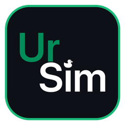
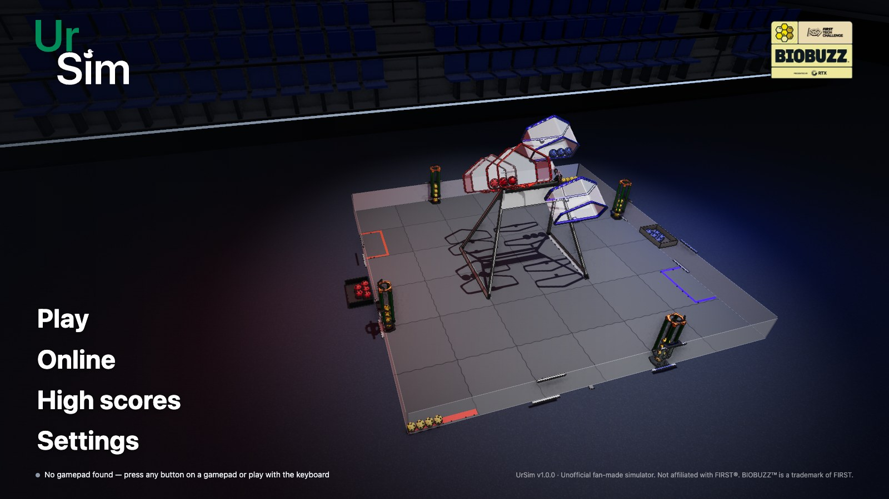
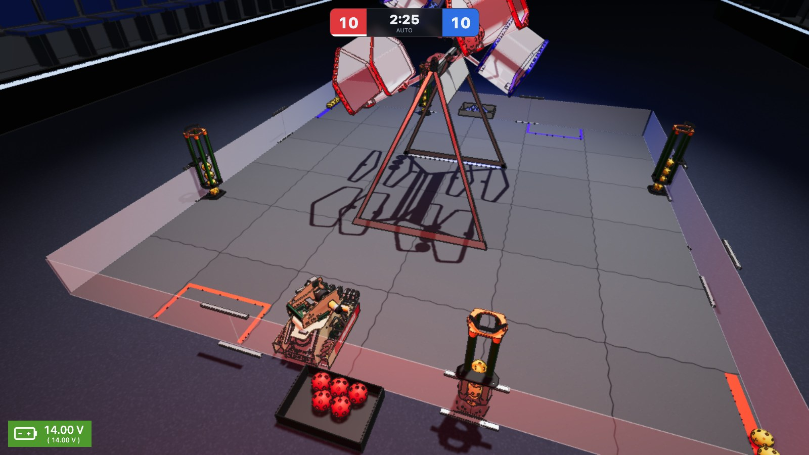
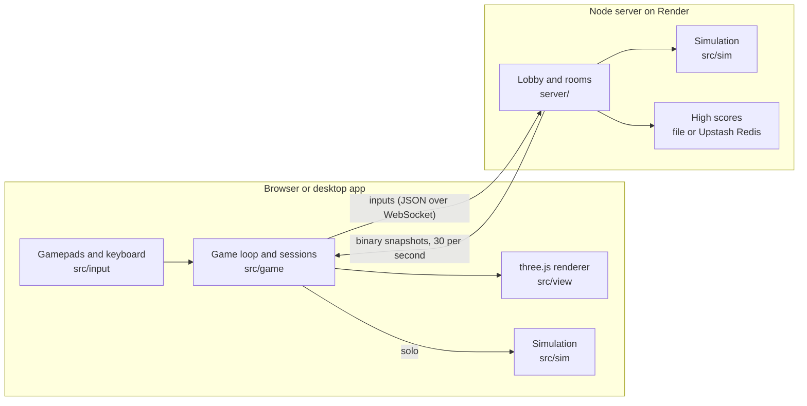

<p align="center"></p>

<h1 align="center">UrSim</h1>

<p align="center">A <i>FIRST</i> Tech Challenge simulator for the 2026–2027 season, <b>BIOBUZZ</b>, made by FTC team <b>URAN92</b></p>

<p align="center"><a href="../../releases/latest"><b>⬇ Download the latest version</b></a> · <a href="https://ursim.onrender.com">Play in the browser</a> · <a href="README.ru.md">Русский</a></p>



Drive **URAN V1** or **Bumble V**, real competition robots built from their teams' CAD (mecanum drive, auto-aiming turret, intake and flywheel shooter), around the BIOBUZZ field. Collect POLLEN, launch it into your HIVE to tip it, and play full **2:30 matches** with live scoring and an automatic referee, or practice without a clock. Play **online 1 vs 1 or 2 vs 2** with friends: they join your room with a 4-letter code. Every robot has its own **top 100 high score** table. The interface is in English and Russian.



## Download

Every version is on the [Releases](../../releases) page. Pick the zip for your computer:

| System | File |
|---|---|
| Windows 10 / 11 (64-bit) | `UrSim_<version>_Windows.zip` |
| macOS 12 or newer (Intel and Apple Silicon) | `UrSim_<version>_Mac.zip` |
| Linux (64-bit) | `UrSim_<version>_Linux.zip` |

No install needed to play in the browser: **https://ursim.onrender.com** (Chrome, Edge, Firefox or Safari). The app and the website share the same online server, so they can play together.

### How to start

**Windows.** Unzip the archive (right-click → *Extract All*) and run `UrSim.exe`. If you see *"Windows protected your PC"*, click *More info* → *Run anyway*: the game is not signed with a paid Microsoft certificate.

**macOS.** Unzip the archive and drag `UrSim` into *Applications*. The first time, right-click `UrSim` → *Open* → *Open* (the game is not signed by Apple). If macOS says the app *"is damaged"* or *"cannot be verified"*, open Terminal and run:

```bash
xattr -cr /Applications/UrSim.app
```

**Linux.** Unzip the archive and run `./ursim` from the unzipped folder. If it closes right away with a sandbox error (happens on Ubuntu 24.04 and newer), run this once in that folder:

```bash
sudo chown root:root chrome-sandbox && sudo chmod 4755 chrome-sandbox
```

Press `F11` for fullscreen. PS4, PS5 and Logitech F310 gamepads or the keyboard; see [Controls](#controls-like-an-ftc-teleop-defaults). If the game runs slowly, set **Settings → Graphics** to *Low* and turn shadows off.

## How it works



**One simulation, two places.** All game logic lives in `src/sim` without any graphics: Rapier physics stepped at 120 Hz, the mecanum drive, the mechanisms, HIVEs, scoring and the referee. In solo play it runs in the browser. Online, the same code runs on the server, which is authoritative: players send only their inputs, the server sends compact binary snapshots back 30 times a second, and the client interpolates between them so motion stays smooth.

**From CAD to game.** The field, HIVEs and game elements are converted from the official BIOBUZZ CAD (STEP → GLB) by scripts in `tools/`, and the field colliders are baked into one binary file that the browser and the server both load. The robot comes from the team's own CAD: a JSON file marks which parts spin (wheels, intake, flywheel, turret) and around which axis, then the model is simplified and its parts are merged by material to cut draw calls.

**Robot physics.** Mecanum kinematics as in an FTC TeleOp (robot-centric or field-centric with an IMU heading), with motor speed scaled by a battery model: 14 V at the start, drained by the flywheel, sagging under load. The turret aims by itself within its cable limit (URAN V1 ±200°, Bumble V a full turn each way) and unwinds through the front; the flywheel speed comes from a ballistic solution for the distance to the HIVE cell, and the spread grows with range.

**Automatic referee.** Six rules from the game manual are judged from physics contacts and match state. Pinning (G421) checks the footprint corners of a robot held against a wall or field element for 3 seconds; ramming the HIVE (G417) uses the contact speed with its frame. Fouls go to the opponent's score, a second yellow card becomes a red one, and every call is listed on the results screen.

**Rendering.** three.js with a post-processing chain: ambient occlusion (GTAO) at half resolution and black outlines from a Sobel filter over normals and depth, plus spotlights and fog for the arena look. Edges are smoothed by FXAA instead of rendering extra pixels, and when the frame rate drops below 50 FPS an adaptive quality ladder lowers the resolution and effects. Merging static meshes cut draw calls from about 650 to about 370 per frame, and simplifying the models (`tools/lighten-model.mjs`) cut the triangles drawn per frame from about 2 million to 0.7 million.

**Desktop app and CI.** The same build runs in Electron, served over a custom `app://` protocol so that fetch, WebAssembly and localStorage work as on the website. GitHub Actions builds the Windows, macOS (universal) and Linux zips on native runners.

**Tests.** 92 Vitest tests in 13 files cover the simulation (scoring, HIVE tipping, battery, transfer), the referee rules, server rooms and house rules, input bindings, high scores and translations.

| Area | Tools |
|---|---|
| Language | TypeScript (about 7,700 lines in `src/` and `server/`) |
| 3D graphics | three.js |
| Physics | Rapier (WebAssembly) |
| Build | Vite, esbuild |
| Server | Node.js, WebSocket (`ws`), hosted on Render |
| Desktop | Electron, electron-builder, GitHub Actions |
| Tests | Vitest |

## Running from source

```bash
npm install
npm run dev
```

Open http://localhost:5173, connect a gamepad (PS4, PS5 or Logitech F310) and press any button.

## Robots

Before a match, practice or online game you pick a robot: team, specs, alliance, camera and drive mode.

- **URAN V1** (team URAN92): model from the team's CAD, mecanum drive on 518 RPM motors with 82 mm wheels (≈2.2 m/s), 9 kg, 44 × 32 cm.
- The turret turns to the target by itself; the wheels, intake, transfer and flywheel spin like on the real robot.
- Shooter accuracy depends on the distance to the cell: within 1 m it almost always scores, at 2.2 m the spread is large.
- The URAN V1 intake can't reach balls inside the flowers.
- URAN V1 picks up and shoots only POLLEN; it drives over NECTAR (`intakes` in `src/robot/robots.ts`).
- **Bumble V** (team SWB): model from the team's CAD, mecanum drive on 522 RPM motors with 96 mm wheels (≈2.6 m/s), 11 kg, 46 × 28 cm. A two-flywheel shooter on a turret that turns a full turn each way. Picks up and shoots only POLLEN. Its front arm (FLOWER mode): lowered at a FLOWER, it pulls the POLLEN out of the bottom by itself, straight into the intake, no intake button needed.

Adding a robot from CAD (STEP):

```bash
pip install cascadio==0.1.1 numpy
python3 -c "import cascadio; cascadio.step_to_glb('Robots/Uran 92 V1/Jedi92.stp', 'robot-raw.glb', tol_linear=0.8, tol_angular=0.45, include_materials=True)"
node tools/convert-robot.mjs robot-raw.glb public/assets/robots/uran-v1.glb tools/robots/uran-v1.json
```

`tools/robots/uran-v1.json` (and `bumble-v.json`) describes the robot's moving parts: which CAD axis is up (`up`: Fusion exports +y or +z) and forward, which CAD parts are the turret, flywheels, intake and transfer shafts and wheels, and which axis each one spins around (`reverse` for one that turns the other way). `fixed` lists parts that never move even when they sit next to a spinning one (for example, belts around the wheel pulleys); `triangles` and `error` set how much the model is simplified. For a new robot, copy this file and adjust the nodes and axes to its CAD, then add the robot to `src/robot/robots.ts`: size, motor, wheels, weight, shooter (including how far its turret turns), team logo in `public/assets/teams/`. A Fusion 360 `.f3z` can't be read without Fusion: export it as STEP with "Save to my computer".

## Modes

- **Match 2:30**: like at a competition: AUTO 30 s → 3 s break → TELEOP 2:00, scoring per the game manual, and an FTC-style results screen at the end (R to play again, Esc for the menu). There is no autonomous code yet: you drive during those 30 seconds yourself.
- **Practice**: no timer; points and HIVE tips are still counted.
- **Online**: a 1 vs 1 room (Red 1, Blue 1) or a 2 vs 2 room (Red 1/2, Blue 1/2), a match or a shared practice. Up to 4 people per room; anyone without a driver spot watches.

A ball that leaves the field comes back after 5 seconds (manual 10.8.2): POLLEN is placed on the field next to the nearest wall, and NECTAR goes to that alliance's human player, who can bring it back in right away (G427).

During play the screen shows only the timer with the score and the robot battery, like on a Driver Station: a green block with the current voltage and the lowest one this match in brackets. A match starts at 14 V; a flywheel left spinning drains the battery and the robot drives slower (motor speed is proportional to voltage).

The turret can't spin endlessly (its wires would twist): URAN V1's turns at most 200° each way (Bumble V's a full turn), and when the target moves past that, the turret swings back around through the front.

The camera is chosen before the game: **driver view**, **audience view** (from the stands) or **follow robot** (behind the robot). It can't be changed during a match; only the follow camera looks forward or back with R3 (it doesn't rotate with the robot, it just follows it).

## Rules and referee

In 2:30 matches and online matches the referee enforces the game rules from the manual (section 11.4) by itself. A MINOR FOUL gives the opponent 5 points, a MAJOR FOUL 20 (the FOUL row on the results screen), and a second yellow card becomes a red card: 0 points for the match. Every call is listed on the results screen after the match.

| Rule | Not allowed | Penalty |
|---|---|---|
| G402 | In AUTO, taking balls or pushing an opponent robot on the opponent's half of the field | MAJOR FOUL per match |
| G405 | Launching a ball out of the field (a missed shot doesn't count) | MAJOR FOUL per ball |
| G408 | Taking the opponent's NECTAR | warning, then a yellow card |
| G410 | Scoring NECTAR in a flower before the last minute | MAJOR FOUL per NECTAR |
| G417 | Ramming the HIVE frame (fast, or twice within 10 s) | warning, then MAJOR FOUL and a yellow card |
| G421 | Pinning an opponent against a wall or field element for more than 3 s | MAJOR FOUL, plus another every 3 s |

The other rules the simulator simply doesn't let you break: robots are stopped between periods and after the match (G403, G404), a robot holds at most 4 balls (G407), the intake picks up balls only from the floor (G409) and can't reach into a flower (G418), and the human player brings NECTAR in by the rules (G426–G428). Rules about people, inspection and intent (referee's judgement) are not checked. Practice has no referee.

## High scores

**High scores** in the main menu shows the top 100 single-player 2:30 matches for each robot. Each player has one row: a new best score replaces the old one. The name for the table is entered under high scores or on the robot select screen before a match.

The server keeps the high scores. With no setup it writes them to `data/records.json`, but free Render wipes the disk on every restart, so the website needs a free [Upstash Redis](https://upstash.com) database:

1. Sign in at upstash.com (GitHub works) → **Create Database** → type Redis, region Frankfurt, Free plan.
2. On the database page, open the **REST API** tab and copy `UPSTASH_REDIS_REST_URL` and `UPSTASH_REDIS_REST_TOKEN`.
3. In Render: service `ursim` → **Environment** → **Add Environment Variable** → add both variables with those values → **Save Changes**.

After the restart the server log shows `High scores: upstash`.

## Online

The server runs the online game: players send only their inputs, and the server runs the physics, scoring and timer, so everyone sees the same field.

Running it locally (two terminals):

```bash
npm run dev
```

```bash
npm run server
```

Then **Online → 1 vs 1 room** or **2 vs 2 room**, and friends join with the 4-letter code.

- **Friends on the same Wi-Fi:** run `npm run dev:lan` instead of `npm run dev`; friends open `http://<your Mac's IP>:5173`.
- **Over the internet:** the server is hosted on [Render](https://render.com) from `render.yaml` (see "Hosting online" below).

The production build is one process that serves both the game and the rooms:

```bash
npm run build && npm run build:server && PORT=8787 npm start
```

The server address can be changed under **Online → Server address** or with a `?server=wss://…` link.

## Settings

**Settings** in the main menu (and in the pause menu):

- **Controls**: drive and turn sensitivity (30–200%), and any gamepad button and any key can be rebound: click it in the table, then press the button or key you want (Esc cancels). If it's already used by another action, the two swap. "Reset controls" restores the defaults below.
- **Graphics**: quality (Auto / High / Medium / Low), shadows, black outlines, anti-aliasing, FPS counter. Auto lowers the resolution and ambient occlusion by itself when the frame rate drops below 50.
- **Rules**: fouls, cards and the battery (voltage sag that slows the robot) can be turned off. Online games use the host's settings.
- **Language**: English or Russian. The default comes from the browser: Russian for a Russian browser, English otherwise. FTC terms (POLLEN, NECTAR, HIVE, AUTO, TELEOP, MAJOR FOUL) stay as in the game manual in both.
- **Gamepads**: which gamepad is gamepad1 and gamepad2, a button tester, and setup for non-standard gamepads.

Everything is saved in the browser right away.

## Controls (like an FTC TeleOp, defaults)

| Action | PS4 / PS5 | Logitech F310 | Keyboard |
|---|---|---|---|
| Drive and strafe | left stick | left stick | W A S D |
| Turn | right stick | right stick | Q / E |
| Intake: pick up balls in front (hold, up to 4) | L1 | LB | F |
| Eject balls (hold) | ↓ | ↓ | K |
| Shooter on | L2 | LT | Z |
| Shooter off | R2 | RT | V |
| Transfer: balls into the shooter (hold; the intake spins too and feeds new balls straight to the shooter) | R1 | RB | Space |
| Slow mode (toggle) | L3 | L3 | Shift |
| Field-centric ↔ robot-centric | Share / Create | Back | Tab |
| Reset heading (IMU) | Options | Start | Enter |
| Follow camera: forward / back | R3 or touchpad | R3 | C |
| Pause | PS | Logitech | Esc |
| Restart | — | — | R |

The mechanisms listen to both gamepad1 and gamepad2, so two people can drive one robot.

The turret aims at the top cell of its own HIVE and sets the flywheel speed by itself. Shoot from the side the cell's opening faces (after a tip, from the other side).

The F310 has a mode switch on the back: **X** on Windows, **D** on Mac. If the buttons are mixed up, open **Gamepads → Set up buttons**.

## Desktop app and releases

The game also comes as an app for Windows, macOS and Linux (Electron, in `desktop/`): the same game in its own window, with online rooms and high scores going through the Render server. Ready-made builds are on the [Releases](../../releases) page.

Running the app locally:

```bash
npm run desktop
```

A new release:

1. Bump the version in `package.json` (it's shown in the game menu) and commit.
2. Tag and push the tag. GitHub Actions ("Desktop app") builds the zips for Windows, macOS and Linux on its own machines and attaches them to a draft release for that tag:

```bash
git tag v1.0.1 && git push origin v1.0.1
```

3. When the build finishes, write the notes and publish the draft:

```bash
gh release edit v1.0.1 --notes "What's new: …" --draft=false
```

"Publish zips" in Actions attaches the zips of an earlier "Desktop app" run to a release without building again.

The Mac build is signed without an Apple certificate, so macOS asks for permission on the first launch (see [How to start](#how-to-start)).

## Hosting online (Render, free)

1. Push this repository to your own GitHub account (or fork it).
2. Go to [render.com](https://render.com), sign in with GitHub → **New → Blueprint** → pick the repository → **Apply**.
3. After 3–5 minutes the game is live at an address like `https://ursim-xxxx.onrender.com`. Send that link to your friends.

The server is in Frankfurt (change `region` in `render.yaml`). The free server sleeps after 15 minutes without players; the first visit after that takes about a minute. Every `git push` to `main` updates the game automatically.

Health check: `https://<address>/health`.

## Tuning

- `TIP_LOAD`, `NECTAR_WEIGHT` and `TIP_DELAY` in `src/sim/HiveSim.ts`: a HIVE tips 3 s after its top cell holds the weight of 10 POLLEN (a NECTAR weighs as much as 2 POLLEN: 10 POLLEN = 5 NECTAR). At the start of a match the cell already holds 3 NECTAR (manual 10.3.1), so the first tip needs only 4 POLLEN.
- `SHOOTER` in `src/sim/Mechanisms.ts`: flywheel speed, entry angle.
- `shooter.fireInterval` in `src/robot/robots.ts`: seconds between shots (URAN V1 0.2 s, Bumble V 0.4 s).
- `ROBOT_HIT` in `src/sim/Simulation.ts`: how much speed a ball keeps as it leaves a robot that hit it.
- `shooter.sweetSpot` / `shooter.maxRange` in `src/robot/robots.ts`: the robot's accurate shooting range.

## Layout

- `Field/`, `Manual/`, `Logo/`, `Robot/`: source material (CAD, game manual, logo).
- `tools/convert-balls.mjs`: POLLEN and NECTAR from the official CAD (`Field/am-5851…`, `am-5852…`) into `public/assets/balls.glb`.
- `tools/lighten-model.mjs`: simplifies a finished model (fewer triangles, same moving parts) when the CAD isn't at hand.
  The field was made with `error 0.003 --drop-normals`, the robot with `0.01`, the balls with `0.02`.
- `tools/convert-field.mjs` turns the field CAD (STEP) into `public/assets/field.glb` and `field-layout.json`; `tools/build-colliders.mjs` builds the field colliders for the browser and the server (`field-colliders.bin`). Both: `npm run convert:field`.
- `src/sim/`: the whole game without graphics: physics, robots, mechanisms, HIVEs, match, scoring, network snapshots. Runs in the browser (solo) and on the server.
- `src/net/`: protocol, online session, smooth snapshot interpolation; `server/`: the game server with rooms.
- `src/view/`: draws the field, arena, balls and robots from the world state.
- `src/input/`: gamepads (button names as in the FTC SDK), keyboard, button setup wizard.
- `src/robot/`: mecanum drive math (as in an FTC TeleOp) and the robot list (`robots.ts`).
- `src/field/`: HIVE cell geometry from CAD, zones, floor texture.
- `src/game/`: game loop, sessions (solo / online), scoring, auto-aim ballistics.
- `src/camera/`, `src/ui/`: cameras, menus, HUD, scoreboard, results.

## Checks

```bash
npm test
npm run build
```

## License

The code is released under the [MIT License](LICENSE). The field, HIVE and game element models are converted from *FIRST*'s official BIOBUZZ CAD, and the BIOBUZZ logo is a *FIRST* trademark; the URAN V1 robot model and the URAN logo belong to team URAN92, the Bumble V model and the SWB logo to team SWB.

Unofficial fan project, not affiliated with *FIRST*®. *FIRST*®, *FIRST*® Tech Challenge and BIOBUZZ™ are trademarks of *FIRST*.
