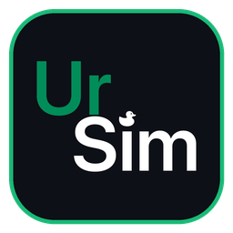
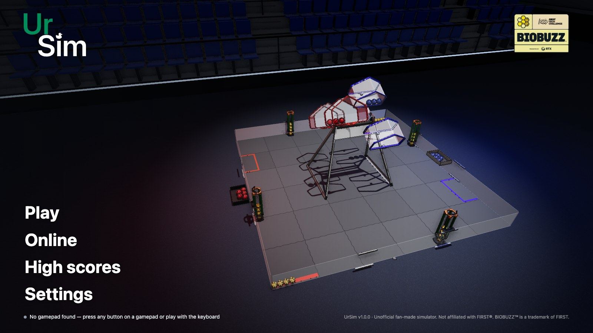
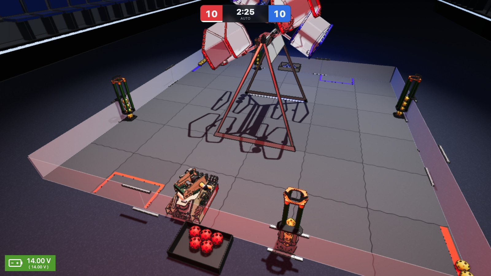
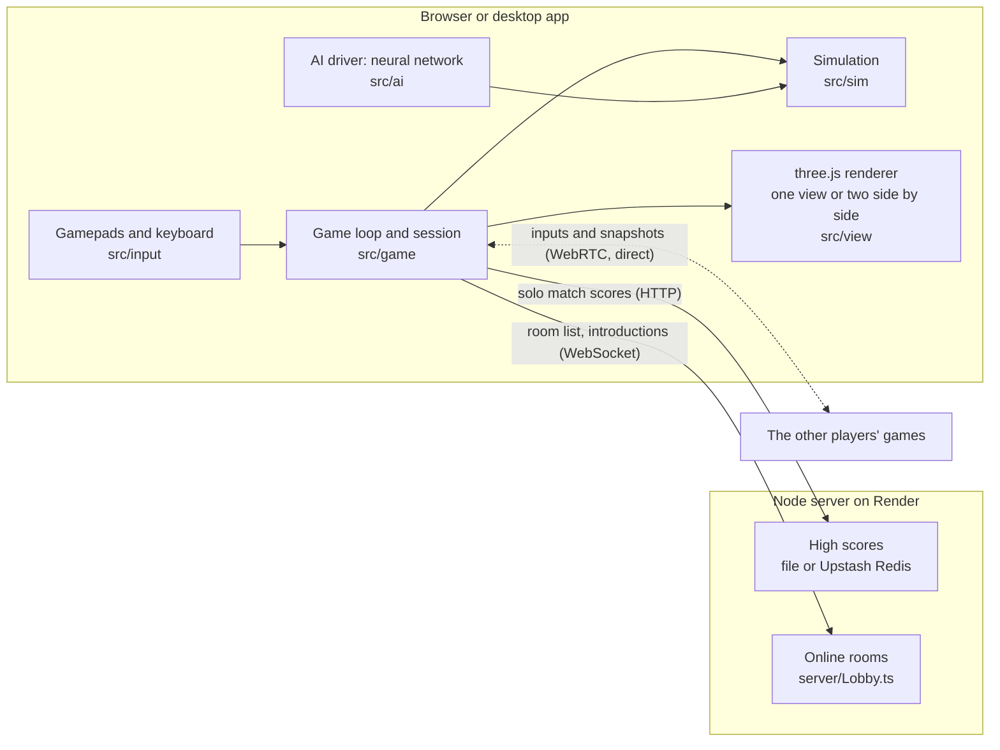

<p align="center"></p>

<h1 align="center">UrSim</h1>

<p align="center">A <i>FIRST</i> Tech Challenge simulator for the 2026–2027 season, <b>BIOBUZZ</b>, made by FTC team <b>URAN92</b></p>

<p align="center"><a href="../../releases/latest"><b>⬇ Download the latest version</b></a> · <a href="https://ursim.onrender.com">Play in the browser</a> · <a href="README.ru.md">Русский</a></p>



Drive **URAN V2**, **Bumble V**, **Silver Bullet Blaster**, **Sirius Shadow**, **Bobik**, **Ri3D**, **Mechatronics** or **DHB**, real robots built from their teams' CAD (mecanum drive, auto-aiming turret, intake and flywheel shooter), around the BIOBUZZ field. Collect POLLEN, launch it into your HIVE to tip it, and play full **2:30 matches** with live scoring and an automatic referee, or practice without a clock. With two gamepads, two people play on one computer on a **split screen**: each drives their own robot and sees the field through their own camera. Alone, play against the **AI**, a neural network trained in the simulator: 1 vs 1, or 2 vs 2 with an AI partner, at **easy, medium or hard**; two players on a split screen can team up against it. **Online**, play 1 vs 1 or 2 vs 2 in rooms, open or closed with a password. Every robot has its own **top 100 high score** table. The interface is in English, Russian and Kazakh.



## Download

Every version is on the [Releases](../../releases) page. Pick the zip for your computer:

| System | File |
|---|---|
| Windows 10 / 11 (64-bit) | `UrSim_<version>_Windows.zip` |
| macOS 12 or newer (Intel and Apple Silicon) | `UrSim_<version>_Mac.zip` |
| Linux (64-bit) | `UrSim_<version>_Linux.zip` |

No install needed to play in the browser: **https://ursim.onrender.com** (Chrome, Edge, Firefox or Safari). The app and the website share the same high score tables.

### How to start

**Windows.** Unzip the archive (right-click → *Extract All*) and run `UrSim.exe`. If you see *"Windows protected your PC"*, click *More info* → *Run anyway*: the game is not signed with a paid Microsoft certificate.

**macOS.** Unzip the archive and drag `UrSim` into *Applications*. The first time, right-click `UrSim` → *Open* → *Open* (the game is not signed by Apple). If macOS says the app *"is damaged"* or *"cannot be verified"*, open Terminal and run:

```bash
xattr -cr /Applications/UrSim.app
```

**Linux.** Unzip the archive and run `./ursim` from the unzipped folder. If it closes right away with a sandbox error (happens on Ubuntu 24.04 and newer), run this once in that folder:

```bash
sudo chown root:root chrome-sandbox && sudo chmod 4755 chrome-sandbox
```

Press `F11` for fullscreen. Any gamepad (Xbox, PlayStation, Nintendo Switch, Logitech, 8BitDo and others) or the keyboard; see [Controls](#controls-like-an-ftc-teleop-defaults). If the game runs slowly, set **Settings → Graphics** to *Low* and turn shadows off.

## How it works



**Simulation without graphics.** All game logic lives in `src/sim` without any graphics: Rapier physics stepped at 120 Hz, the mecanum drive, the mechanisms, HIVEs, scoring and the referee. It runs in the browser; the renderer only draws the world state the simulation reports, blended between the last two physics steps by the time since the last one (`src/game/Session.ts`), so robots move evenly at any frame rate, 30, 75 or 144 FPS alike, and the game keeps real time down to 10 FPS.

**Split screen.** With two gamepads the session holds two robots, each fed by its own gamepad. The scene is drawn into the left and right half of one canvas (viewport and scissor) through two cameras, each half with its own post-processing chain, and the shadow map is drawn once a frame for both.

**Online.** The room's admin runs the match in their browser and the other players connect to it directly over WebRTC, sending inputs and getting compact binary snapshots 60 times a second through a channel that never waits for a lost packet; the server only keeps the room list (see [Online](#online)).

**From CAD to game.** The field, HIVEs and game elements are converted from the official BIOBUZZ CAD (STEP → GLB) by scripts in `tools/`, and the field colliders are baked into one binary file that the browser loads. The robot comes from the team's own CAD: a JSON file marks which parts spin (wheels, intake, flywheel, turret) and around which axis, then the model is simplified and its parts are merged by material to cut draw calls.

**Robot physics.** Mecanum kinematics as in an FTC TeleOp (robot-centric or field-centric with an IMU heading), with motor speed scaled by a battery model: 14 V at the start, drained by the flywheel, sagging under load. The turret aims by itself within its cable limit (URAN V2 ±200°, Bumble V, Silver Bullet Blaster and Sirius Shadow half a turn each way: all 360°, Bobik, the Ri3D, Mechatronics and DHB 135° each way) and unwinds through the front; the flywheel speed comes from a ballistic solution for the distance to the HIVE cell, and the spread grows with range. Balls leave each shooter spinning the way the team's do (`shooter.spin`): URAN V2's and Sirius Shadow's with frontspin, Silver Bullet Blaster's with a little (its hood's rollers turn with the ball), Bumble V's, Bobik's, the Ri3D's and DHB's with none (two wheels squeeze them evenly), Mechatronics' with backspin (the ball rolls along the hood over the flywheel). A spinning ball curves in the air (the Magnus force, lift coefficient S / (2S + 1) of the spin factor S = rω / v: about a twentieth of g for a POLLEN at 5 m/s) and kicks when it bounces; the auto-aim allows for the curve, so frontspin shots fly a little faster and drop into the cell more steeply, backspin ones slower.

**Automatic referee.** Six rules from the game manual are judged from physics contacts and match state. Pinning (G421) checks the footprint corners of a robot held against a wall or field element for 3 seconds; ramming the HIVE (G417) uses the contact speed with its frame. Fouls go to the opponent's score, a second yellow card becomes a red one, and every call is listed on the results screen.

**Rendering.** The hall around the field has a vaulted roof of light steel ribs over dark glass, blue bench stands with aisles and rails, and a lighting truss over the field; its surfaces light themselves a little instead of a hall light, so the field keeps its own lighting. three.js with a post-processing chain: ambient occlusion (GTAO) at half resolution and black outlines from a Sobel filter over normals and depth, plus spotlights and fog for the arena look. Edges are smoothed by FXAA instead of rendering extra pixels, and when the frame rate drops below 50 FPS an adaptive quality ladder lowers the resolution and effects. Merging static meshes cut draw calls from about 650 to about 370 per frame, and simplifying the models cut the triangles drawn per frame from about 2 million to 0.7 million. A robot further than 2.4 m from the camera shows its lighter model (5–6× fewer triangles): a 2 vs 2 frame went from 1.77 to 0.56 million triangles and about 1.5× less GPU time. Robot models are made part by part from the team CAD (`tools/convert-robot.mjs`): 140–210 thousand triangles for the full one, 25–34 thousand for the lighter one, with every shaft, pulley and gear of a mechanism turning, clean mecanum wheels and brushed aluminium that reflects more of the hall than the field does. The hall is drawn once, without the outline and ambient occlusion pre-pass.

**Desktop app and CI.** The same build runs in Electron, served over a custom `app://` protocol so that fetch, WebAssembly and localStorage work as on the website. GitHub Actions builds the Windows, macOS (universal) and Linux zips on native runners.

**Tests.** 267 Vitest tests in 30 files cover the simulation (scoring, HIVE tipping, battery, transfer, defence), G304 start positions, the referee rules and house rules, the AI driver and its levels, online rooms and network play, replays, input bindings, high scores and translations.

| Area | Tools |
|---|---|
| Language | TypeScript (about 11,900 lines in `src/` and `server/`) |
| 3D graphics | three.js |
| Physics | Rapier (WebAssembly) |
| Build | Vite, esbuild |
| Server | Node.js (the game files, high scores and the online room list), hosted on Render |
| Desktop | Electron, electron-builder, GitHub Actions |
| Tests | Vitest |

## Running from source

```bash
npm install
npm run dev
```

Open http://localhost:5173, connect a gamepad (any) and press any button.

## Robots

Before a match or practice you pick a robot: alliance, camera and drive mode, with a card of the robot's figures (rapid fire, weight, drive, top speed, turret, the flywheel's weight and the intake motor's speed where the team gave them, what it picks up, Flower Mode, ball spin). A robot two teams built from one CAD has one card: the Ri3D, WXYZ's Robot in 3 Days that RoboRangers built Bobik from, shows WXYZ's logo with RoboRangers' in the corner, and **Switch to RoboRangers** / **Switch to WXYZ** next to its name changes the model (the figures are the same). The card remembers the one picked last, and each has its own high score table (`basedOn` in `src/robot/robots.ts`). With a second gamepad connected, the same screen has rows for gamepad2's robot and alliance (see [Split screen](#split-screen)).

**Start position.** The "Start position" row (also in an online room) shows the field from above with your wall at the bottom. The left stick (or WASD, or the mouse) moves the robot and the right stick (Q / E, the mouse wheel) turns it; the walls and the center line stop it, it stays on the wall while it turns, and it squares up near 45° and 90°. The robot is tinted green where rule G304 lets it start: fully on its own side, touching the wall, not touching a FLOWER, not in the LOADING ZONE or on the GARDEN's POLLEN, and off the partner's robot; red otherwise, with the reason. Save (Ⓐ / Enter) keeps the start for this robot, Standard (Ⓨ / R) goes back to the usual spot at the alliance wall, Cancel (Ⓑ / Esc) changes nothing. Starts are kept as for the red side; on blue the robot stands the same way, turned about the field center. If the spot is taken in a game after all, the robot starts on its usual one (`src/field/startPose.ts`, `src/ui/StartPositionScreen.ts`).

- **URAN V2** (team URAN92; it replaced URAN V1): model from the team's CAD, mecanum drive on 518 RPM motors with 82 mm wheels (≈2.2 m/s), 9 kg, 44 × 32 cm (53 cm with the arm down). Rapid fire: all 4 balls in 0.2 s, and the intake takes a ball every 0.175 s, twice as fast as the other robots. Flower Mode: the U-shaped push-back arm in front of the intake, like Bumble V's.
- The turret turns to the target by itself; the wheels, intake, transfer and flywheel spin like on the real robot.
- Shooter accuracy depends on the distance to the cell: within 1 m it almost always scores, at 2.2 m the spread is large.
- Defence: when two robots run into each other faster than 0.7 m/s, both turrets are knocked off their aim for 2 s, and only about 3 in 4 shots score even from up close.
- With the arm up, the URAN V2 intake can't reach balls inside the flowers.
- URAN V2 picks up and shoots only POLLEN; it drives over NECTAR (`intakes` in `src/robot/robots.ts`).
- **Bumble V** (team SWB): model from the team's CAD, mecanum drive on 522 RPM motors with 96 mm wheels (≈2.6 m/s), 11 kg, 46 × 28 cm. A two-flywheel shooter on a turret that turns half a turn each way (360° in all). Picks up and shoots only POLLEN. Rapid fire: 4 balls in 0.7 s. Its front arm (Flower Mode): lowered at a FLOWER, it pushes the POLLEN out of the bottom into the push back. Lowered right up against a FLOWER, a wall or a robot, the arm swings down only until it touches and rests there; it goes the rest of the way as the robot backs off.
- **Silver Bullet Blaster** (team SWB): model from the team's CAD, mecanum drive on 435 RPM motors with 104 mm wheels (≈2.4 m/s), 12.5 kg, 42 × 37 cm (55 cm with the arm down). Picks up both POLLEN and NECTAR and has **two turrets**, each fed by its own lane: the left one shoots POLLEN, the right one NECTAR, both at once. Rapid fire: 4 balls in 1 s. Flower Mode like Bumble V's: a U-shaped arm on the front intake axle, lifted by a servo winch; lowered, it can't take balls off the floor but pushes POLLEN out of a FLOWER into the push back.
- **Sirius Shadow** (team Mooneye): model from the team's CAD, mecanum drive on 518 RPM motors with 104 mm wheels (2.82 m/s in theory, 2.4–2.5 m/s on the field), 9 kg, 38 × 30 cm (41 cm to the front of the intake wheels). Picks up both POLLEN and NECTAR and has **two turrets** one behind the other, each turning half a turn each way (all 360°): the back one shoots POLLEN, the front one NECTAR. Its intake sorts them by size: behind the Moosetake wheels, NECTAR is too big to drop between two rails and rides up them into the front turret, while POLLEN drops between them onto the ramp that carries it back up into the back turret. A gecko wheel standing at each front corner turns balls in, so it takes balls across its whole front, but not from beside it (`intakeHalfWidth`). Rapid fire: 4 balls in 0.4 s. No Flower Mode.
- **Ri3D** (team WXYZ, 19705) and **Bobik** (team RoboRangers, 25590): one robot on one card. WXYZ made it in their Robot in 3 Days for 2026–27, and RoboRangers built Bobik from its CAD; Bobik closes the back with plates where WXYZ's has four linear slides (44 cm high, Bobik 37 cm). Both models come from the teams' CAD, and both play with WXYZ's figures: mecanum drive at 435 RPM on 104 mm wheels (≈2.4 m/s), 9 kg, a 36 × 33 cm box frame with the intake 6 cm out in front (51 cm with the arm down). One turret that turns 135° each way (270° in all): a flywheel low at the front and a roller high at the back squeeze the ball as it comes up through the turret's ring, so it flies without spin. Four roller shafts on one motor at 2000 RPM carry balls under them up a 7.4 cm channel: POLLEN only, a ball every 0.2 s. Rapid fire: 4 balls in 0.3 s. Flower Mode: two side plates on the frame's front corners with a plate across their ends. Raised, the arm stands out in front of the intake, high enough for balls to roll under it but solid against walls and robots (`arm.raisedBox`); lowered 50°, the plate lies 2–4 cm over the tiles, and the POLLEN it pulls out of a FLOWER waits on it (`arm.pocketLift`).
- **Mechatronics** (team 13368): model from the team's CAD, mecanum drive at ~500 RPM on 104 mm wheels (≈2.7 m/s), a 39 × 29 cm frame with the intake's flexible stars 4 cm out in front. One turret on a ring bearing, turned by two servos 135° each way (270° in all). Its flywheel is a 72 mm wheel at the turret's front, driven by a motor on each side and weighted to 800 g: the ball rises behind it along an adjustable hood and leaves forward over its top, rolling along the hood, so it flies with backspin. The heavy flywheel spins up about 2.7 times slower than the usual one (about a second instead of 0.4 s), but each shot takes only about 4% of its speed instead of 10% (`shooter.flywheelMass`). Three flexible stars and a vectored wheel at each end of the front shaft take balls in, and compliant wheels carry them up a curved ramp and through the turret's ring: POLLEN only. No Flower Mode. The team gave no weight or rapid fire: 11 kg and 4 balls in 0.5 s are estimates.
- **DHB** (team MLP, 19163): model from the team's CAD, mecanum drive at 611 RPM on 104 mm wheels, each turned by its motor through an 11:110 helical gear: 3.3 m/s, the fastest robot in the game. 11.5 kg, a 32 × 30 cm frame with the intake 8 cm out in front and guides at its corners that turn balls in (49 cm with the arm down). One turret on a 79-tooth ring gear, turned 135° each way (270° in all) by two servos through the gear behind it; a 3" flex wheel low at its front and three 1.625" ones high at its back, each on its own motor, squeeze the ball as it comes up through the ring, so it flies without spin. A shaft of 72 mm wheels across the front takes balls in, and more rollers carry them over a curved ramp of two rails that turns up into the turret's ring: the channel is 7.6 cm wide, POLLEN only. The intake motor turns at 1800 RPM: a ball every 0.22 s. Rapid fire: 4 balls in 0.5 s. Flower Mode: the U-shaped push-back arm on the front intake shaft, lifted by two servos; raised, it leans back over the intake, and lowered, its cross plate lies 1–3 cm over the tiles, where the POLLEN it pulls out of a FLOWER waits.

**Push back (Flower Mode: URAN V2, Bumble V, Silver Bullet Blaster, Bobik, the Ri3D and DHB).** The lowered arm blocks the floor. Once its front bar is in a FLOWER's retrieval opening (under the middle ring, up to the support at the wall), it pushes the bottom POLLEN back into the push back, between the bar and the intake rollers. The ball waits there and travels with the robot until you run the intake (or the transfer); then the rollers catch it and the next one is pushed out as soon as it has dropped to the bottom by itself, so a FLOWER empties as fast as its balls fall (about 0.15 s a ball, like the blocks of a VEX loader tube), until the robot holds 4 (G407). Ram the FLOWER (faster than 0.4 m/s) and the balls in its tube hop; the next one comes out once they have landed again. Lift the arm and the ball stays on the floor in front of the intake. All the lowered arms are low (up to 9 cm, as in their CAD), so the front bar slides under the middle ring. The AI runs its intake whenever its push back holds a ball, keeps the arm down until it has taken it, and backs off when the arm rests on something instead of coming down.

Adding a robot from CAD (STEP):

```bash
pip install cascadio==0.1.1 numpy
python3 -c "import cascadio; cascadio.step_to_glb('Robots/Uran 92 V2/Jedi92.step', 'robot-raw.glb', tol_linear=0.25, tol_angular=0.2, include_materials=True)"
node tools/convert-robot.mjs robot-raw.glb public/assets/robots/uran-v2.glb tools/robots/uran-v2.json public/assets/robots/uran-v2-low.glb
```

`tools/robots/uran-v2.json` (and the others) describes the robot's moving parts: which CAD axis is up (`up`: Fusion exports +y or +z) and forward, assemblies to leave out (`drop`), which CAD parts are the turret, flywheels, intake and transfer shafts and wheels, and which axis each one spins around (`reverse` for one that turns the other way). `fixed` lists parts that never move even when they sit next to a spinning one (for example, belts around the wheel pulleys); `detail` and `lowDetail` set how far (m) a part's surface may move as it is simplified, in the full and the lighter model (every CAD part is simplified on its own, so plates keep their thickness and round parts stay round), and `translucent` lists CAD colors of clear panels to show see-through (STEP files lose transparency), or their CAD names (`name`) where solid parts have the same color. The game's arm rests lowered in the model: an arm the CAD shows raised gives `turn` (rad about its axle; negative swings the front end down), and the model is written with it turned that far. The converter also leaves out parts that can't be seen from anywhere around or above the robot, turns whatever sits on the axis of a roller, wheel or flywheel with it (shafts, pulleys, gears, hubs; `coaxial: false` stops that), and rebuilds a wheel rule with `mecanum: true` as a clean mecanum wheel of the same size and colors, its rollers leaning the way the CAD's do (`mecanum.slant` sets it when the CAD has the wrong hand of wheel in a corner, `mecanum.match` names the wheel's assembly). A lift's stages give `slide` (how far up they go, m; what rides on them names them as `parent`), and the converter keeps whatever shows with them down or up; `swing` (rad) is how far the game turns a part to an angle (a shooter's adjustable hood, a box's stopper); `colorTolerance` merges nearly equal CAD colors into one material, for fewer draw calls; `split` names CAD nodes whose one mesh holds several bodies (an unnamed STEP solid, like DHB's turret ring gear fused with the gear that drives it), so each of its pieces finds its own rule. For a new robot, copy this file and adjust the nodes and axes to its CAD, then add the robot to `src/robot/robots.ts`: size, motor, wheels, weight, shooter (including how far its turret turns), where held balls sit (`storage`: one place per ball along the path balls take through the CAD, from the shooter back to the intake's mouth), team logo in `public/assets/teams/`; for a folding arm, `node tools/arm-reach.mjs <model.glb> <upAngle>` measures `arm.reach`. A Fusion 360 `.f3z` can't be read without Fusion: export it as STEP with "Save to my computer".

## Workshop: robots of your own

**Workshop** in the main menu (or the "+ Your robot" card when picking a robot) makes robots of your own. They play in every mode: a match, practice, split screen, against the AI (the AI can drive one too) and online. They never go into the high score tables: anyone could build the fastest robot there is.

- **Build from blocks**: a simple model of plain blocks (the drive base with four wheels, the intakes with their rollers, turrets on towers with their flywheels, and a Flower Mode arm if you want one) in two colors of your choice. Every change shows at once on the robot on the field; drag the field to look around it, the wheel zooms. The tabs set what the robot does: its name, team and number (on its signs); the drive base (length and width inside FTC's 18-inch starting box, frame height, the drivetrain, 60–140 mm wheels, motor RPM, weight; at most 3.2 m/s); the intakes; the turrets. The moving parts turn like the team robots': wheels, swerve modules, intake rollers, flywheels, turrets, the arm.
  - **Drivetrain**: mecanum (any way, 15% slower sideways), swerve (every wheel steers: full speed any way, turning a little slower) or tank (plain wheels in treads: no strafing, but 25% more grip, so it accelerates and pushes harder; the AI turns it toward where it goes).
  - **Intakes**: the front one, and a second one at the back if you want to pick up balls driving either way. Each takes POLLEN, NECTAR or both, with its own width, how far it sticks out and balls a second; one button runs both, and the front one spits balls out. The Flower Mode arm sits in front of the front intake. The AI collects with the front one.
  - **Turrets**: 1 to 5, each set on its own: what it shoots (any ball, or POLLEN or NECTAR only: a lane each, like Silver Bullet Blaster's), where it stands on the frame, the height balls leave at, which way it faces at rest and how far it turns from there (0: fixed, aim with the robot), rapid fire and ball spin. "+" adds one set like the one picked, laid out neatly with the others (or where there is most room, if you moved them); "Same for all turrets" and "Line them up" help with many. They fire together, each its own ball, and each flywheel loads the battery. The first is the main one, whose shots the HUD shows. Every ball the robot can hold has a turret that shoots it: the Workshop won't leave one without.
- **Upload a 3D model** of your robot from CAD: GLB, glTF (one file), OBJ or STL, up to 2.5 million triangles. The game tells its units from its size (mm, cm, inches or metres; you can change them) and which axis is up from the kind of file (Y for glTF and OBJ, Z for STL; changeable too), and turns it to face forward in quarter turns. A model without colors of its own takes the frame color. The robot takes its size from the model; how it drives and shoots is set on the same tabs as for blocks. Boxes on the field show how it fits: the frame is what collides, green is where the intake takes balls, orange where they leave, yellow the lowered arm. An uploaded model shows only on your computer: online, the other players see your robot's blocks.
- **Test drive** saves the robot and starts practice with it; "Main menu" in the pause menu brings you back to its editor.
- **Sharing**: "Save as file" writes a `.ursimbot` file with the robot and its 3D model; "Copy code" gives a short `URSIM-ROBOT:…` text for a chat (blocks only, no model). "Open a robot file" or a pasted code adds it to your robots; "Duplicate" makes a copy to change.
- **Online** your robot goes into the room as its blueprint: the admin's game simulates it and everyone sees it (as blocks). The server checks it against the same limits (`server/Lobby.ts`).
- **Gallery**: the Workshop's "Gallery" tab lists the robots players published, newest or most added first, with a search by name, team or author. Pick one and it shows on the field (its 3D model comes along: by itself up to 8 MB, on a press if bigger); "Add to mine" makes it one of your robots, "Test drive" also drives it at once. Publishing takes an account (on the website): "Publish to the gallery" puts your robot there with its picture and 3D model (up to 25 MB) under your username; publishing it again updates it, and "Take down" removes it (players who added it keep theirs). Everyone has up to 20 robots there. A robot reported by 3 signed-in players is hidden until a moderator looks at it: moderators, set on the server with `GALLERY_ADMINS` (usernames, comma-separated, e.g. in `/etc/ursim.env`), can take down any robot and put hidden ones back. The server keeps the list in its database and the pictures and models as files next to it (`GALLERY_DIR` moves them; `server/Gallery.ts`, `src/net/galleryProtocol.ts`).

Your robots are kept in the browser (the list in localStorage, 3D files in IndexedDB) and, while you are signed in, with your account too (up to 50 robots and 250 MB of models): sign in on another computer and they are there. The newest version of a robot wins, and one deleted on any computer goes from the others; robots made while signed out join the account that signs in next (`server/AccountRobots.ts`, `src/net/robotSync.ts`). The code: `src/robot/custom.ts` (the blueprint, its limits and the robot it makes), `src/robot/customStore.ts` (keeping and sharing), `src/view/customModel.ts` (the block model, reading and fitting 3D files, card pictures), `src/ui/Workshop.ts` (the screen).

## Modes

Every game starts with a 3-2-1 countdown on screen: the field, the clock and the robots wait for it.

- **Match 2:30**: like at a competition: 3-2-1 → AUTO 30 s → 8 s transition ("Drivers, pick up your controllers" for 5 s, then 3-2-1) → TELEOP 2:00 (END GAME in the last 30 s), scoring per the game manual, and at the end the season's RED WINS! / BLUE WINS! animation, then the results screen of a real FTC event (R to play again, Esc for the menu; any of these, Enter or Space skips the animation, and a tie goes straight to the results): the WINNER box, the LEAVE & PARK, HIVE, FLOWER, GARDEN and FOUL rows, each team with its place in the qualification ranking of the matches played since the page opened, the Ranking Points earned (WIN 3, TIE 1, SWARM at 16 LEAVE + PARK points, POLLINATOR 1 and 2 at 4 and 7 TIPS, manual table 10-3) and, under each alliance, which robots PARKED in its LOADING ZONE at the end of AUTO and of the match (5 points each, manual 10.5). Settings → Interface chooses the score during the match: live, only the points earned and what for (fouls and cards wait for the results), or nothing until the results. On the field the LOADING ZONES have their tape and a light wash of the alliance colour, which pulses in the last 8 s of AUTO and the last 15 s of the match. There is no autonomous code yet: you drive during those 30 seconds yourself.
  The sounds are a recording of a real FTC field timer, and its display plays on one screen beside the far side of the field (red drivers see it on their left, blue drivers on their right) (`src/game/matchTimer.ts`, `src/view/TimerScreens.ts`). The game clock leads and the recording follows, holding with the pause menu. The game clock loses time on slow frames, so the recording runs ahead; it then plays a little slower or waits silently for the game, but never jumps back, so lines like "Drivers, pick up your controllers" are never heard twice. A recording more than 0.5 s behind skips ahead, and in a background tab it stops along with the game. The scoreboard at the top then shows only the scores.
- **Practice**: no timer; points and HIVE tips are still counted.
- **Split screen**: either of the two above for two players with two gamepads, each with their own robot and half of the screen.
- **With the AI**: either of the two above with robots a neural network drives, easy, medium or hard: 1 vs 1 against one, or 2 vs 2 with an AI partner against two; on a split screen it takes the free driver stations (see [AI opponent](#ai-opponent)).
- **Online**: a 2:30 match or endless practice in a room, 1 vs 1 or 2 vs 2, with the AI on any free station (see [Online](#online)).

A ball that leaves the field comes back after 5 seconds (manual 10.8.2): POLLEN is placed on the field next to the nearest wall, and NECTAR goes to that alliance's human player, who can bring it back in right away (G427).

During play the screen shows only the timer with the score and the robot battery, like on a Driver Station: a green block with the current voltage and the lowest one this match in brackets. A match starts at 14 V; a flywheel left spinning drains the battery and the robot drives slower (motor speed is proportional to voltage). On a split screen each half shows its driver's gamepad, slot and battery.

The turret can't spin endlessly (its wires would twist): URAN V2's turns at most 200° each way (Bumble V's, Silver Bullet Blaster's and Sirius Shadow's half a turn: all 360°, Bobik's, the Ri3D's, Mechatronics' and DHB's 135°, 270° in all), and when the target moves past that, the turret swings back around through the front.

The camera is chosen before the game: **driver view**, **audience view** (from the stands) or **follow robot** (behind the robot). It can't be changed during a match; only the follow camera looks forward or back with R3 (it doesn't rotate with the robot, it just follows it).

## Rules and referee

In 2:30 matches the referee enforces the game rules from the manual (section 11.4) by itself. A MINOR FOUL gives the opponent 5 points, a MAJOR FOUL 20 (the FOUL row on the results screen), and a second yellow card becomes a red card: 0 points for the match. Every call is listed on the results screen after the match.

| Rule | Not allowed | Penalty |
|---|---|---|
| G402 | In AUTO, taking balls or pushing an opponent robot on the opponent's half of the field | MAJOR FOUL per match |
| G405 | Launching a ball out of the field (a missed shot doesn't count) | MAJOR FOUL per ball |
| G408 | Taking the opponent's NECTAR | warning, then a yellow card |
| G410 | Scoring NECTAR in a flower before the last minute | MAJOR FOUL per NECTAR |
| G417 | Ramming the HIVE frame (fast, or twice within 10 s) | warning, then MAJOR FOUL and a yellow card |
| G421 | Pinning an opponent against a wall or field element for more than 3 s | MAJOR FOUL, plus another every 3 s |

The other rules the simulator simply doesn't let you break: robots are stopped between periods and after the match (G403, G404), a robot holds at most 4 balls (G407), the intake picks up balls only from the floor (G409) and can't reach into a flower (G418), and the human player brings NECTAR in by the rules (G426–G428). Rules about people, inspection and intent (referee's judgement) are not checked. Practice has no referee.

## High scores

**Records → Leaderboard** in the main menu shows the top 100 of a period: an FTC season (September to August; the first is BIOBUZZ 2026–27) or one of its months. **High scores · Solo** are 2:30 matches alone with no AI, for each robot or all of them together (Overall); **Duo** are split-screen matches with both robots in one alliance. Each player has one row: a new best score replaces the old one. Signed-in players appear with their @username (their row opens their career); a guest appears by the name entered under Records or on the robot select screen. **Ranked** is the online ladder (see Accounts below). Older versions of the game keep showing the all-time table of each robot (`/api/records`), which solo runs still go into. Robots players make in the [Workshop](#workshop-robots-of-your-own) are in no table.

The server keeps the high scores. With no setup it writes them to `data/records.json`, but free Render wipes the disk on every restart, so the website needs a free [Upstash Redis](https://upstash.com) database:

1. Sign in at upstash.com (GitHub works) → **Create Database** → type Redis, region Frankfurt, Free plan.
2. On the database page, open the **REST API** tab and copy `UPSTASH_REDIS_REST_URL` and `UPSTASH_REDIS_REST_TOKEN`.
3. In Render: service `ursim` → **Environment** → **Add Environment Variable** → add both variables with those values → **Save Changes**.

After the restart the server log shows `High scores: upstash`, and `https://<address>/health` shows `"records": "upstash"` (`"file"` means the tables are lost on the next restart).

Without a database the tables still come back after a restart, only less surely. Each browser keeps a copy of every table it has seen and its own bests, and sends a restarted server the rows it lost, with their dates (at start and when High scores opens). On a deploy the new server also copies the tables from the old one while it still answers. A record no other browser saw before the restart returns only when its player comes back, so the database is still the way to keep every record.

Running the high score server locally next to the game (two terminals):

```bash
npm run dev
```

```bash
npm run server
```

The production build is one process that serves both the game and the high scores:

```bash
npm run build && npm run build:server && PORT=8787 npm start
```

Another high score server can be picked with a `?server=https://…` link.

## Accounts, statistics and friends

The main menu shows how many players have ever finished a game (signed-in players by account, guests by browser), how many accounts there are, how many games were played (Solo — one player, also against the AI; Duo — split screen; 1v1 and 2v2 — online rooms; Practice — 20 s or more) and how many of them with a signed-in player (accounts and such games from before the server counted them are counted once at its start, from the match histories), how many people have the game open right now (`● 4 online · 3 signed in`, from a small WebSocket every open game keeps, `/presence`), links to Instagram and GitHub, and **Download** for the desktop game.

**Sign in with Google**, or **with an e-mail and a password** (the button at the top right), makes an account with a unique @username (changeable under Records → Career → Edit). Signed-in players get **Records → Career**: games played, win rate, playtime, best score and rating for a period or all time, and their match history (the last 200 games) with filters by type and result, and the **match archive**: their latest 30 matches (Match 2:30, solo, split screen or online), each to watch again.

**Replays.** After any match, V (Y on a gamepad) on the results watches it again, even without an account; a signed-in player's matches also go into the archive (`server/Replays.ts`, about 2 MB each, gzipped, next to the database or in `REPLAYS_DIR`). The replay plays at 0.25–2× with a timeline, the highlights (start, volleys, HIVE tips, finish) and eight cameras: free (drag to turn, wheel to zoom, right-drag to move, WASD and Q / E to fly, Shift faster), orbit, director, top, either driver, audience and follow. In the replay, **● Record from here** saves it as a video (see [Replay studio](#replay-studio)). Esc goes back. During a game, **▶ Watch the demo** in the pause menu shows it so far: a match records itself, practice once you press **● Start recording** (REC and the time in the corner; **■ Stop recording** keeps it to watch until the game ends). Online the game goes on meanwhile, your robot standing still, and the recording too; ○ / B on a gamepad leaves the replay. Anyone's career opens from their row in a table. **Friends** (the tab at the right edge): add a player by @username, accept or decline requests, see who is online and which room they're in, and join it in one click.

**Ranked**: an online 2:30 match where a signed-in player drives every robot (no AI, no guests) changes each player's Elo rating (everyone starts at 1000, K = 32; in 2v2 each alliance's average counts) in the season's and the month's ladder. The room's admin's game reports how the match ended; the server counts it once for everyone in the room.

Accounts, sessions, statistics, friends and the period tables are kept like the high scores: in `data/db.json` by default (`DB_FILE` moves it), in the Upstash database when its two variables are set. **On free Render the website needs Upstash for accounts**: without it every restart forgets them.

### Setting up Google sign-in

Google sends players back only to a real domain (one under the public suffix list, never an IP address). The VPS answers at `https://2-135-146-200.sslip.io`; if Google refuses that address in step 3, give the server a free name first: create `ursim` at [duckdns.org](https://www.duckdns.org) pointing to `2.135.146.200` (Caddy already serves `ursim.duckdns.org` and gets its certificate by itself) and use `https://ursim.duckdns.org` below.

1. Open [Google Cloud Console](https://console.cloud.google.com/) → create a project (for example `UrSim`).
2. **Google Auth Platform → Branding**: app name `UrSim`, support e-mail, the game's address → **Audience**: External → **Publish app** (in Testing only listed test users can sign in). The game asks only for `openid` and `profile` (the player's name), no e-mail, so no verification is needed.
3. **Clients → Create client** → type **Web application**:
   - Authorized redirect URIs: `https://<the game's address>/auth/google/callback` and, for testing on your computer, `http://localhost:8787/auth/google/callback`
   - Authorized JavaScript origins can stay empty (the server does the sign-in, not the page).
4. Put the game's address and the client into the server's `/etc/ursim.env` and restart it. This asks for the secret on the server, so it never lands in a chat or a file on your computer:

   ```bash
   ssh -t ursim 'read -p "Client ID: " id; read -s -p "Client secret: " secret; echo; printf "PUBLIC_URL=https://2-135-146-200.sslip.io\nGOOGLE_CLIENT_ID=%s\nGOOGLE_CLIENT_SECRET=%s\n" "$id" "$secret" >> /etc/ursim.env; chmod 600 /etc/ursim.env; systemctl restart ursim'
   ```

   The log (`ssh ursim journalctl -u ursim -n 10`) then shows `Sign-in: e-mail, google`, and the game offers "Sign in with Google". With the DuckDNS name, `PUBLIC_URL` is `https://ursim.duckdns.org`, and `AUTH_ORIGINS=https://2-135-146-200.sslip.io` keeps sign-in working from the old address. On Render the steps are the same with `GOOGLE_CLIENT_ID` and `GOOGLE_CLIENT_SECRET` under **Environment** (Render sets the address itself).

A player's first Google sign-in makes their account and asks them to pick the name others see and their @username, prefilled from Google (`Me.needsName`); changing them later is in the career. The desktop app signs in in the player's browser and gets the session back on 127.0.0.1 (`desktop/signin.cjs`, as RFC 8252 asks of native apps), because Google refuses sign-ins inside an app's own window.

**E-mail sign-in** needs no setup: the server keeps only a scrypt hash of the password (`server/emailAuth.ts`), never shows the address to anyone, and makes an address wait 15 minutes after 10 wrong passwords. There is no password reset by e-mail yet (the server sends no mail).

A game on another address that may sign in through this server goes into `AUTH_ORIGINS` (comma-separated origins). For local testing without Google, `AUTH_DEV_LOGIN=1 npm run server` adds a name-only test sign-in — never set it on a public server.

The Steam version will sign in with Steam: one more provider in `server/auth.ts` (OpenID 2.0 on the website, a session ticket in the desktop game) linked to the same kind of account.

## Split screen

Connect two gamepads (any) and open **Play → Match 2:30** or **Practice**. The robot select screen gets rows for gamepad2: **gamepad2 → Own robot**, its robot and its alliance; gamepad1 picks its robot from the cards as usual. Press Start and each player drives their own robot with their own gamepad on their own half of the screen: gamepad1 on the left, gamepad2 on the right, each with the camera picked before the game.

- The same alliance for both (Red 1 and Red 2, or Blue 1 and Blue 2) is a team; different alliances play 1 vs 1.
- **AI** makes it a 2 vs 2: a team of two gets two AI opponents (**2 opponents, 2 vs 2**), and two players in different alliances an AI partner each (**A partner each, 2 vs 2**), driving at the **AI level** picked (see [AI opponent](#ai-opponent)).
- Either gamepad pauses the game. The keyboard plays for gamepad1.
- Defence works: ramming the other robot knocks both turrets off their aim for 2 s (see [Robots](#robots)).
- **gamepad2 → Operator (FTC)** keeps one robot on the whole screen, and gamepad2 runs its mechanisms like a second FTC driver.
- Which controller is gamepad1 and which gamepad2: **Settings → Gamepads → Swap gamepad1 ↔ gamepad2**.

## Online

**Online** in the main menu: rooms where players are still missing, 1 vs 1 or 2 vs 2. Type your name, then join a room or make your own (**New 1 vs 1 room**, **New 2 vs 2 room**). Whoever makes a room is its admin (★):

- the room is open by default, so anyone can join. **Close with a password** asks for 4 English letters: the room list then shows a lock, and joining asks for those letters (any case). **Open the room** lifts the password;
- **+ AI** on a free driver station puts the neural network there, on the admin's team or against it, and **AI robot ›** changes its robot; **✕ Remove AI** frees the station. So a 2 vs 2 can be the admin with an AI teammate against two AI, and when players come, each one who joins (or clicks **Take this place**) takes over from the AI. **AI level** in the room rules makes every AI in the room easy, medium or hard (a new room starts with the level its admin picked on the robot select screen);
- **Room rules**, the same for everyone: the mode (**Match 2:30**, or endless like **Practice**), warnings and cards, fouls, the battery (its voltage sag and the voltage on screen) and **Score during a match** (live, only the points earned on the field with fouls at the end, or only at the end). A new room starts with the admin's own Settings → Rules and Interface;
- **Start the match** starts the game for everyone. After a 2:30 match, R takes everyone back to the room; an endless game ends with **End the game for everyone** in the admin's pause menu.

In the room each player picks a free driver station (**Take this place**), their robot (**My robot**), and their own **Camera** and **Drive mode** (field-centric or robot-centric); **Settings** opens the controls, graphics, sound and language. Camera and drive mode can also be switched in the pause menu during a game. Next to each player the room shows how the admin's game reaches them: **direct** or **via server**. Every player's name shows in their alliance's colour, red or blue: in the room, and during the game over their robot (the AI's as **AI**; your own only in replays) (`src/view/RobotView.ts`).

**Quick play** puts you in the open room (no password, no match on, a free station) with the most players. With none, players looking at the same time get a new 2 vs 2 room together with the usual rules; after 10 seconds alone you get that room to wait in, and the next players land there. A quick-play room starts its match by itself 30 seconds after two players are in (at least 15 seconds after someone new joins); its admin can start sooner, for example with the AI.

**Why it doesn't lag.** The match runs in the admin's browser, like a solo game with the AI, and the other players connect to it directly (WebRTC data channels): each sends its driver input 60 times a second and gets 60 snapshots of the field back (about 1 KB each). Snapshots and inputs go through a channel that never resends: a lost one is simply replaced by the next, so nothing waits. Presses (shooter, Flower Mode) travel as counters, so a lost packet can neither lose a press nor repeat it. The other players draw the admin's field 40–80 ms in the past, blended smoothly between snapshots (`src/net/interpolate.ts`). The server (`server/Lobby.ts`) only keeps the room list, checks passwords and introduces the players to each other; when a direct connection can't be made (some mobile networks), the same data goes through it at 30 snapshots a second. `?relay` in the address forces that path, to check it.

The admin's game must keep running: online the pause menu doesn't stop the match (the admin's robot just stands still), and the admin's tab should stay in front. If the admin leaves, the match ends and the next player becomes the room's admin.

## AI opponent

On the robot select screen, **AI → Opponent, 1 vs 1** puts a robot on the other alliance that a neural network drives; **2 vs 2 with a partner** also puts one beside you on your alliance, against two. **AI robot** picks their robot and **AI level** how well they drive: **easy**, **medium** (the default) or **hard**, in a 2:30 match or in practice. The pause menu changes the level during the game. On a split screen the AI takes the free driver stations (see [Split screen](#split-screen)); online the room's admin places it and picks its level (see [Online](#online)).

**Levels** (`src/ai/skill.ts`). The network always decides what to do; a lower level carries it out like a less practiced driver. Points a match in the arena against the teacher (`npm run arena:bot -- easy medium hard`, 28 matches each):

| Level | How it drives | Points |
|---|---|---|
| Hard | the network at its best | 151 |
| Medium | 80% of top speed, ½ s late off the line, 0.3–0.7 s to think after a full load and after shooting it, shots scatter 5° more | 94 |
| Easy | 45% of top speed and slower turns, 1.5 s late off the line, 1.2–2 s to think, stops to shoot (its turret aims only with the robot still), shots scatter 8° more | 49 |

**2 vs 2.** The AI minds the nearer opponent and plays with its partner, a player too: it leaves the balls and FLOWERs nearer to the partner to them, shoots from beside it, and the two park at the two ends of the loading zone.

How it was made (`src/ai/`, `tools/`):

- **Teacher.** A hand-written driver (`teacher.ts`) that plays BIOBUZZ: it collects the balls its intake takes that are quickest to reach, or lowers its arm at a FLOWER and pushes the POLLEN out of it into the push back (Flower Mode); with a full load it heads for the nearest good spot in front of the upward cell of its HIVE and fires as soon as it is in range and the flywheel is up to speed, still rolling in. It stays on its own half in AUTO (G402) and parks at the end. It only plays during training.
- **What the network sees.** 69 numbers, 20 times a second (`features.ts`): its position, speed, load, shooter and arm; the four balls quickest to reach and the best FLOWER to empty; the way to its shooting spot; the other robot; the HIVE frame, the nearest FLOWER and wall; the clock. Positions are in the robot's own frame, so it plays the same from either alliance.
- **The network.** A multilayer perceptron 69 → 128 → 128 → 7 with ReLU, written from scratch in TypeScript (`mlp.ts`), no ML library. Its outputs are the drive, strafe and turn sticks (tanh) and the intake, transfer, shooter and arm buttons (sigmoid).
- **Training: imitation learning with DAgger.** The teacher plays games and every decision is recorded with what it saw; the network learns to do the same (Adam, squared error for the sticks, cross-entropy for the buttons). Then the network drives while the teacher keeps saying what it would have done, and those examples (exactly the situations the network gets itself into) are added before it trains again: 6 rounds, about 870,000 examples, the games played in parallel worker threads.
- **Reflexes.** Under the network, like a robot's own safety code (`action.ts`): it slows down next to the HIVE frame (G417), keeps the intake off with the opponent's NECTAR in front of it (G408), lets go of an opponent it pushes or stands against before that counts as a pin (G421), and backs off when it is stuck.
- **No lag.** One decision (inputs and network) takes about 0.1 ms in the browser, inside the physics step, 20 times a second.

The teacher's strategy was tuned in matches (`npm run arena:bot`, which plays variants against each other): pulling POLLEN out of FLOWERs instead of standing around waiting, the nearest shooting spot and firing on the move took it from 160 to 202 points a match (56 matches each, scored as in the manual).

In the same matches the network averaged 180 points and the teacher 202: 89% of its teacher, with 8.3 HIVE tips a match and 0.02 fouls, and it won half of its matches against the teacher. With the robots and rules of today the arena gives the network (hard) about 145–150 points a match and the teacher 165.

Training it again (about 35 minutes on 8 cores) writes `src/ai/policy.json`:

```bash
npm run train:bot
```

## Replay studio

After a match, **V** on the results screen (Y on a gamepad), **Watch the demo** in the pause menu, or **Watch** in the career's archive opens the studio (the developer build, `npm run dev`, also records every practice from its start; the field 30 times a second, about 6 MB a match):

- a timeline with pause (Space), ±5 s (←/→) and 0.25×–2× speed; the match sounds play along at normal speed;
- cameras (keys 1–8): **Free** (drag to turn, wheel to zoom, right-drag to move), **Orbit**, **Director** (a low chase camera that cuts to the robot doing the most), **Top**, the red and blue **driver** views, **Audience**, and **Follow** (press it again for the next robot); H hides the panel;
- **● Record from here** (next to the speeds) saves the replay from the current moment, or from the start once it has reached the end, as a 1920 × 1080 video with the match sounds (MP4, or WebM where the browser has no MP4) until **■ Stop and save** or the end; cameras can be switched while it records. **Highlights**: the start, every volley (3 balls or more within 1.2 s), every HIVE tip and the finish are found by themselves (two rows, the rest scroll); ● next to one saves just that clip, and **Record all** saves them one after another, each with a camera that suits it (`src/ui/ReplayStudio.ts`, `src/game/replay.ts`).

## Settings

**Settings** in the main menu (and in the pause menu):

- **Controls**: drive and turn sensitivity (30–200%), and any gamepad button and any key can be rebound: click it in the table, then press the button or key you want (Esc cancels). If it's already used by another action, the two swap. "Reset controls" restores the defaults below.
- **Graphics**: quality (Auto / **Ultra** / High / Medium / Low; Ultra draws at least twice the screen's pixels, with full-resolution ambient occlusion, a 4096 shadow map with soft edges and robots always in full detail, and Auto never goes above High), shadows, black outlines, anti-aliasing, FPS counter, and **Field lights**: Off, **Glow** (LED strips in the alliance colours on top of the field wall, breathing slowly) or **Final** (the strips plus eight moving lights on the truss over the field running a show in time: a wave, a turning ring, crossing beams, a fan, a chase, the alliance ends, and every few seconds all of them swing onto the robots, which two real spotlights then light up; `src/view/FieldLights.ts`). Auto lowers the resolution and ambient occlusion by itself when the frame rate drops below 50.
- **Sound**: match sounds (the field timer) and the click of menu buttons, each on or off.
- **Rules**: fouls, cards and the battery (voltage sag that slows the robot) can be turned off, and so can **shooting on the move**: off, as for a team without that code, a turret aims only while its robot stands still and shots don't allow for the robot's motion, so a ball fired on the move misses (the AI stops to shoot). It applies to every robot in the match, online too (the room admin's rules).
- **Language**: English, Russian or Kazakh. The game starts in English; a language picked here is kept. FTC terms (POLLEN, NECTAR, HIVE, AUTO, TELEOP, MAJOR FOUL) stay as in the game manual in all of them.
- **Gamepads**: which gamepad is gamepad1 and gamepad2, a button tester, and button setup for any gamepad.

Everything is saved in the browser right away.

## Controls (like an FTC TeleOp, defaults)

| Action | PS4 / PS5 | Xbox, Logitech and others | Keyboard |
|---|---|---|---|
| Drive and strafe | left stick | left stick | W A S D |
| Turn | right stick | right stick | Q / E |
| Intake: pick up balls in front (hold, up to 4) | L1 | LB | F |
| Eject balls (hold) | ↓ | ↓ | K |
| Shooter on | L2 | LT | Z |
| Shooter off | R2 | RT | V |
| Transfer: balls into the shooter (hold; the intake spins too and feeds new balls straight to the shooter) | R1 | RB | Space |
| Flower Mode on: arm down, take from a FLOWER | ✕ | A | X |
| Flower Mode off: arm up | △ | Y | Y |
| Field-centric ↔ robot-centric | Share / Create | Back | Tab |
| Reset heading (IMU) | Options | Start | Enter |
| Follow camera: forward / back | R3 or touchpad | R3 | C |
| Pause | PS | Xbox / Logitech / Home | Esc |
| Restart | — | — | R |

With two gamepads each player drives their own robot with these buttons on a split screen; in **Operator (FTC)** mode the mechanisms listen to both gamepads instead, so two people drive one robot. The keyboard always plays for gamepad1.

The turret aims at the top cell of its own HIVE and sets the flywheel speed by itself. Shoot from the side the cell's opening faces (after a tip, from the other side).

Every gamepad plays (`src/input/gamepad.ts`). PlayStation, Xbox 360, Xbox One / Series, Nintendo Switch and the F310 show their own button names; a Switch pad goes by position, so its bottom button **B** does what **A** does on an Xbox pad. Other makers' pads that name a family get its names (REV's PS4 compatible gamepad REV-31-2983 shows ✕ ○ □ △), and a DualShock 4 copy the browser doesn't know (L2 / R2 on axes 3 and 4) gets the DualShock 4's own button order. On a PC the REV gamepad turns into an Xbox pad, so **Gamepads → Button names** switches any pad between PlayStation, Xbox and Nintendo names (kept per pad in the browser). Any other pad is called by its own name and shows A B X Y. A pad the browser has no standard layout for plays with guessed buttons (left stick on the first two axes, right stick on the next two resting in the middle, triggers resting at an end, a POV hat as the d-pad) until they are set up; such a pad (unknown and without a standard layout) takes gamepad1 or gamepad2 once a button is pressed on it, so a device that only calls itself a gamepad takes no slot.

The F310 has a mode switch on the back: **X** on Windows (it then shows up as Xbox 360), **D** on Mac. macOS has no driver for the Xbox 360 controller, so on a Mac it isn't seen. If the buttons are mixed up, open **Gamepads → Set up buttons**.

## Desktop app and releases

The game also comes as an app for Windows, macOS and Linux (Electron, in `desktop/`): the same game in its own window, with the high scores kept on the Render server. Ready-made builds are on the [Releases](../../releases) page.

Running the app locally:

```bash
npm run desktop
```

A new release:

1. Bump the version in `package.json` (it's shown in the game menu) and commit.
2. Tag and push the tag. GitHub Actions ("Desktop app") builds the zips for Windows, macOS and Linux on its own machines and attaches them to a draft release for that tag:

```bash
git tag v1.0.1 && git push origin v1.0.1
```

3. When the build finishes, write the notes and publish the draft:

```bash
gh release edit v1.0.1 --notes "What's new: …" --draft=false
```

"Publish zips" in Actions attaches the zips of an earlier "Desktop app" run to a release without building again.

The Mac build is signed without an Apple certificate, so macOS asks for permission on the first launch (see [How to start](#how-to-start)).

## Hosting the website (Render, free)

1. Push this repository to your own GitHub account (or fork it).
2. Go to [render.com](https://render.com), sign in with GitHub → **New → Blueprint** → pick the repository → **Apply**.
3. After 3–5 minutes the game is live at an address like `https://ursim-xxxx.onrender.com`. Send that link to your friends.

The server is in Frankfurt (change `region` in `render.yaml`). The free server sleeps after 15 minutes without players; the first visit after that takes about a minute. Every `git push` to `main` updates the game automatically.

Health check: `https://<address>/health`.

## Hosting on your own server (VPS)

A small VPS does not sleep, so the website opens at once and keeps its high scores in a file. `deploy/` has a systemd service, a Caddy config that gets the HTTPS certificate by itself, and an update script; [deploy/README.md](deploy/README.md) walks through it step by step (in Russian).

## Tuning

- `TIP_LOAD`, `NECTAR_WEIGHT`, `TIP_DELAY` and `TIP_DURATION` in `src/sim/HiveSim.ts`: a HIVE tips once its top cell holds the weight of 8 POLLEN (a NECTAR weighs as much as 2 POLLEN: 8 POLLEN = 4 NECTAR). It sags for 0.6 s and turns over in 1.4 s, 2 s in all. As in the manual (10.5), a tip scores 20 and each ball scores 2 only if it is still in the upward cell at the end of the match: the ones that spill out at a tip don't. At the start of a match the cell already holds 3 NECTAR (manual 10.3.1), so the first tip needs only 2 POLLEN.
- `SHOOTER` in `src/sim/Mechanisms.ts`: flywheel speed, entry angle.
- `shooter.rapidFire` in `src/robot/robots.ts`: seconds from the first to the last of 4 balls (URAN V2 0.2 s, Bumble V 0.7 s, Silver Bullet Blaster 1 s, Sirius Shadow 0.4 s per turret, Bobik and the Ri3D 0.3 s, Mechatronics and DHB 0.5 s); `shooter.spin`: the ball's spin as a fraction of rolling (1 frontspin, 0 none, negative backspin: Mechatronics -1); `intakeInterval`: seconds between balls the intake takes in (URAN V2 0.175 s, the others 0.35 s), or `intakeRpm`, the intake motor's speed, which scales the usual 0.35 s (taken as a 1150 RPM intake, `INTAKE` in `src/sim/Mechanisms.ts`): the Ri3D and Bobik at 2000 RPM take a ball every 0.2 s, DHB at 1800 RPM every 0.22 s; `shooter.flywheelMass`: the flywheel's weight if not the usual 0.3 kg (`SHOOTER.flywheelMass`): Mechatronics' 0.8 kg changes speed 2.7 times slower, but each shot takes 2.7 times less of its speed, so it recovers in the same time.
- `ROBOT_HIT` in `src/sim/Simulation.ts`: how much speed a ball keeps as it leaves a robot that hit it.
- `KNOCK` in `src/sim/Mechanisms.ts` and `KNOCK_SPEED` in `src/sim/Simulation.ts`: how long and how much a robot hit throws the turrets off, and how hard the hit must be.
- `shooter.sweetSpot` / `shooter.maxRange` in `src/robot/robots.ts`: the robot's accurate shooting range.

## Layout

- `Field/`, `Manual/`, `Logo/`, `Robot/`: source material (CAD, game manual, logo).
- `tools/convert-balls.mjs`: POLLEN and NECTAR from the official CAD (`Field/am-5851…`, `am-5852…`) into `public/assets/balls.glb`.
- `tools/lighten-model.mjs`: simplifies a finished model (fewer triangles, same moving parts) when the CAD isn't at hand.
  The field was made with `error 0.003 --drop-normals`, the robot with `0.01`, the balls with `0.02`.
- `tools/convert-field.mjs` turns the field CAD (STEP) into `public/assets/field.glb` and `field-layout.json`; `tools/build-colliders.mjs` builds the field colliders (`field-colliders.bin`). Both: `npm run convert:field`.
- `src/sim/`: the whole game without graphics: physics, robots, mechanisms, HIVEs, match, scoring.
- `src/net/`: online play (lobby connection, WebRTC links, the admin's and the other players' side of a match, snapshot blending) and the high score tables; `server/`: the web server (game files, high scores, room list); `deploy/`: running it on your own server.
- `src/view/`: draws the field, arena, balls and robots from the world state.
- `src/input/`: gamepads (button names as in the FTC SDK), keyboard, button setup wizard.
- `src/robot/`: mecanum drive math (as in an FTC TeleOp), the robot list (`robots.ts`) and robots players make (`custom.ts`, `customStore.ts`).
- `src/field/`: HIVE cell geometry from CAD, zones, floor texture.
- `src/game/`: game loop (one view or a split screen), session, scoring, auto-aim ballistics.
- `src/ai/`: the AI driver: teacher, inputs, network, reflexes, levels, training games; `tools/train-bot.ts` trains it and `tools/bot-arena.ts` compares drivers.
- `src/camera/`, `src/ui/`: cameras, menus, HUD, scoreboard, results.
- `public/assets/sound/`: the field timer recording (`match-timer.mp3`, and `match-timer.mp4` cut to the display and without sound) and the button click.

## Checks

```bash
npm test
npm run build
```

## License

The code is released under the [MIT License](LICENSE). The field, HIVE and game element models are converted from *FIRST*'s official BIOBUZZ CAD, and the BIOBUZZ logo is a *FIRST* trademark; the URAN V2 robot model and the URAN logo belong to team URAN92, the Bumble V and Silver Bullet Blaster models and the SWB logo to team SWB, the Sirius Shadow model and the Mooneye logo to team Mooneye, the Bobik model and the RoboRangers logo to team RoboRangers, the Ri3D model and the WXYZ logo to team WXYZ, the Mechatronics model and logo to team Mechatronics, the DHB model and the MLP logo to team MLP. The match sounds and timer display are a recording of the FTC match timer; the button click is from Mixkit (free license).

Unofficial fan project, not affiliated with *FIRST*®. *FIRST*®, *FIRST*® Tech Challenge and BIOBUZZ™ are trademarks of *FIRST*.
