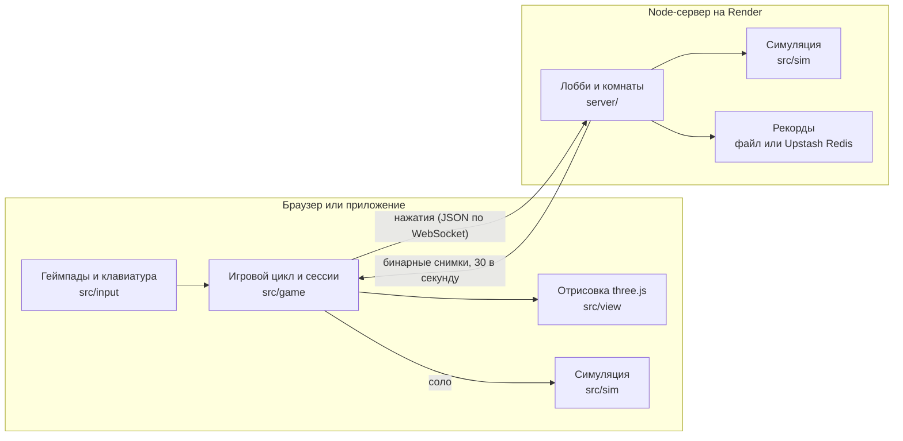

<p align="center"></p>

<h1 align="center">UrSim</h1>

<p align="center">Симулятор FIRST Tech Challenge сезона 2026–2027 <b>BIOBUZZ</b> от команды <b>URAN92</b></p>

<p align="center"><a href="../../releases/latest"><b>⬇ Скачать последнюю версию</b></a> · <a href="https://ursim.onrender.com">Играть в браузере</a> · <a href="README.md">English</a></p>


Водишь робота **URAN V1** или **Bumble V** (мекан-шасси, автоматическая турель, интейк и шутер) по полю BIOBUZZ: собираешь POLLEN, переворачиваешь улей, играешь «Матч 2:30» с подсчётом очков и судьёй по мануалу или тренируешься без таймера. **Онлайн 1 на 1 или 2 на 2**: друзья заходят в твою комнату по коду из 4 букв. Есть таблица рекордов для каждого робота. Интерфейс на русском и английском.


## Скачать

Все версии лежат на странице [Releases](../../releases). Выбери архив под свою систему:

| Система | Файл |
|---|---|
| Windows 10 / 11 (64-бит) | `UrSim_<версия>_Windows.zip` |
| macOS 12+ (Intel и Apple Silicon) | `UrSim_<версия>_Mac.zip` |
| Linux (64-бит) | `UrSim_<версия>_Linux.zip` |

Без установки можно играть в браузере: **https://ursim.onrender.com** (Chrome, Edge, Firefox, Safari). Приложение и сайт ходят на один сервер, так что могут играть вместе.

### Как запустить

**Windows.** Распакуй архив (правый клик → «Извлечь всё») и запусти `UrSim.exe`. Если появится «Windows защитила ваш компьютер», нажми «Подробнее» → «Выполнить в любом случае»: у игры нет платной подписи Microsoft.

**macOS.** Распакуй архив и перетащи `UrSim` в «Программы». При первом запуске нажми на `UrSim` правой кнопкой → «Открыть» → «Открыть» (у игры нет подписи Apple). Если macOS пишет, что приложение «повреждено» или его «не удаётся проверить», открой Терминал и выполни:

```bash
xattr -cr /Applications/UrSim.app
```

**Linux.** Распакуй архив и запусти `./ursim` из распакованной папки. Если приложение сразу закрывается с ошибкой про sandbox (бывает на Ubuntu 24.04 и новее), выполни один раз в этой папке:

```bash
sudo chown root:root chrome-sandbox && sudo chmod 4755 chrome-sandbox
```

`F11` — полный экран. Геймпады PS4, PS5, Logitech F310 или клавиатура, см. [Управление](#управление-как-в-ftc-teleop-по-умолчанию). Если игра тормозит, поставь в **Настройки → Графика** качество «Низкое» и выключи тени.

## Как устроено



**Одна симуляция в двух местах.** Вся логика игры лежит в `src/sim` и не зависит от графики: физика Rapier с шагом 120 Гц, меканум-шасси, механизмы, ульи, подсчёт очков и судья. В одиночной игре она работает в браузере. В онлайне тот же код работает на сервере, и главный там сервер: игроки шлют только нажатия, сервер 30 раз в секунду рассылает компактные бинарные снимки мира, а клиент плавно интерполирует между ними.

**Из CAD в игру.** Поле, ульи и игровые элементы переводятся скриптами из `tools/` из официального CAD BIOBUZZ (STEP → GLB), а коллизии поля запекаются в один бинарный файл, который читают и браузер, и сервер. Робот взят из CAD команды: в JSON-файле отмечено, какие детали крутятся (колёса, интейк, маховик, турель) и вокруг какой оси. Потом модель упрощается, а детали сливаются по материалам, чтобы было меньше вызовов отрисовки.

**Физика робота.** Кинематика меканума как в FTC TeleOp (относительно робота или поля по IMU). Скорость моторов зависит от модели аккумулятора: 14 В в начале матча, маховик его садит, под нагрузкой напряжение проседает. Турель сама наводится в пределах, которые позволяют провода (URAN V1 ±200°, Bumble V полный оборот в каждую сторону) и разворачивается обратно через перед. Скорость маховика считается по баллистике для расстояния до ячейки улья, а разброс растёт с дальностью.

**Автоматический судья.** Шесть правил из мануала проверяются по контактам в физике и состоянию матча. Прижатие (G421) определяется по углам робота, прижатого к стенке или элементу поля дольше 3 секунд, таран улья (G417) — по скорости удара о его раму. Фолы идут в счёт соперника, вторая жёлтая карточка становится красной, а все нарушения видны на табло после матча.

**Графика.** three.js с цепочкой постобработки: затенение (GTAO) в половинном разрешении и чёрные контуры фильтром Собеля по нормалям и глубине, плюс прожекторы и туман для вида арены. Края сглаживает FXAA, а не лишние пиксели, а если FPS падает ниже 50, качество само снижает разрешение и эффекты. Слияние статичных мешей сократило число вызовов отрисовки примерно с 650 до 370 за кадр, а упрощение моделей (`tools/lighten-model.mjs`) — число треугольников за кадр примерно с 2 млн до 0,7 млн.

**Приложение и CI.** Та же сборка работает в Electron через свой протокол `app://`, поэтому fetch, WebAssembly и localStorage работают как на сайте. GitHub Actions собирает zip для Windows, macOS (universal) и Linux на машинах с этими системами.

**Тесты.** 92 теста на Vitest в 13 файлах: симуляция (очки, переворот улья, аккумулятор, трансфер), правила судьи, комнаты сервера и настройки правил, назначение кнопок, рекорды и переводы.

| Область | Инструменты |
|---|---|
| Язык | TypeScript (около 7 700 строк в `src/` и `server/`) |
| 3D-графика | three.js |
| Физика | Rapier (WebAssembly) |
| Сборка | Vite, esbuild |
| Сервер | Node.js, WebSocket (`ws`), хостинг Render |
| Приложение | Electron, electron-builder, GitHub Actions |
| Тесты | Vitest |

## Запуск из исходников

```bash
npm install
npm run dev
```

Открыть http://localhost:5173. Подключить геймпад (PS4, PS5 или Logitech F310) и нажать любую кнопку.

## Роботы

Перед матчем, тренировкой или онлайном открывается выбор робота: команда, характеристики, альянс, камера и режим управления.

- **URAN V1** (команда URAN92): модель из CAD команды, mecanum на моторах 518 RPM с колёсами 82 мм (≈2,2 м/с), 9 кг, 44 × 32 см.
- Турель сама поворачивается к цели; колёса, интейк, трансфер и маховик крутятся как на настоящем роботе.
- Точность шутера зависит от расстояния до ячейки: до 1 м — почти всегда попадает, к 2,2 м — сильный разброс.
- Захват URAN V1 не достаёт мячи из цветов.
- URAN V1 берёт и бросает только POLLEN, через NECTAR просто проезжает (`intakes` в `src/robot/robots.ts`).
- **Bumble V** (команда SWB): модель из CAD команды, mecanum на моторах 522 RPM с колёсами 96 мм (≈2,6 м/с), 11 кг, 46 × 28 см. Шутер с двумя маховиками на турели, которая поворачивается на полный оборот в каждую сторону. Берёт и бросает только POLLEN. Передняя рука (FLOWER mode): опущенная у цветка, сама вытаскивает POLLEN снизу прямо в интейк, кнопку интейка жать не нужно.

Как добавить робота из CAD (STEP):

```bash
pip install cascadio==0.1.1 numpy
python3 -c "import cascadio; cascadio.step_to_glb('Robots/Uran 92 V1/Jedi92.stp', 'robot-raw.glb', tol_linear=0.8, tol_angular=0.45, include_materials=True)"
node tools/convert-robot.mjs robot-raw.glb public/assets/robots/uran-v1.glb tools/robots/uran-v1.json
```

В `tools/robots/uran-v1.json` (и `bumble-v.json`) описано, какая ось CAD смотрит вверх (`up`: Fusion выгружает +y или +z) и вперёд, и подвижные части робота: какие детали CAD — турель, маховики, валы интейка и трансфера, колёса, и вокруг какой оси они крутятся (`reverse` — в другую сторону). В `fixed` перечислены детали, которые не двигаются, даже если стоят рядом с крутящейся (например, ремни вокруг шкивов колёс); `triangles` и `error` задают, насколько упрощать модель. Для нового робота скопируй этот файл и поправь узлы и оси под его CAD, потом добавь робота в `src/robot/robots.ts`: размеры, мотор, колёса, вес, шутер (и насколько поворачивается турель), логотип команды в `public/assets/teams/`. Файл Fusion 360 `.f3z` без Fusion не прочитать: выгрузи его в STEP с галочкой «Save to my computer».

## Режимы

- **Матч 2:30** — как на соревнованиях: АВТОНОМ 30 с → перерыв 3 с → TELEOP 2:00, подсчёт очков по мануалу, в конце табло как на FTC (R — ещё раз, Esc — в меню). Автонома пока нет: в эти 30 секунд управляешь сам.
- **Тренировка** — без таймера, очки и перевороты считаются.
- **Онлайн** — комната 1 на 1 (Red 1, Blue 1) или 2 на 2 (Red 1/2, Blue 1/2), матч или совместная тренировка. В комнате до 4 человек; кому не хватило места водителя, смотрят.

Мяч, вылетевший за поле, через 5 секунд возвращается (мануал 10.8.2): POLLEN кладётся на поле у ближайшей стенки, NECTAR отдаётся человеку-игроку своего альянса, и тот может сразу ввести его снова (G427).

Во время игры на экране только таймер со счётом и аккумулятор робота, как на Driver Station: зелёный блок с напряжением сейчас и самым низким за матч в скобках. В начале матча 14 В; маховик, который крутится без остановки, садит аккумулятор, и робот едет медленнее (скорость моторов пропорциональна напряжению).

Турель не крутится бесконечно (мешают провода): у URAN V1 она поворачивается не больше чем на 200° в каждую сторону (у Bumble V на полный оборот), а если цель уходит дальше, турель разворачивается обратно через перед.

Камера выбирается перед игрой: **вид водителя**, **вид зрителей** (с трибуны) или **за роботом**. Во время матча камеру менять нельзя; только «за роботом» по R3 смотрит вперёд или назад (камера не поворачивается вместе с роботом, а едет за ним).

## Правила и судья

В «Матч 2:30» и онлайн-матчах судья сам следит за правилами из мануала (раздел 11.4). MINOR FOUL даёт сопернику 5 очков, MAJOR FOUL — 20 (строка FOUL на табло), вторая жёлтая карточка становится красной — 0 очков за матч. Все нарушения перечислены на табло после матча.

| Правило | Что нельзя | Наказание |
|---|---|---|
| G402 | В AUTO брать мячи или толкать робота соперника на его половине поля | MAJOR FOUL за матч |
| G405 | Выбрасывать мяч за поле (промах при броске не считается) | MAJOR FOUL за мяч |
| G408 | Брать NECTAR соперника | предупреждение, потом жёлтая карточка |
| G410 | Забрасывать NECTAR в цветок раньше последней минуты | MAJOR FOUL за NECTAR |
| G417 | Таранить раму улья (быстро или дважды за 10 с) | предупреждение, потом MAJOR FOUL и жёлтая |
| G421 | Прижимать соперника к стенке или элементу поля дольше 3 с | MAJOR FOUL и ещё один каждые 3 с |

Остальные правила симулятор просто не даёт нарушить: роботы стоят между периодами и после матча (G403, G404), в робота помещается максимум 4 мяча (G407), интейк берёт мячи только с пола (G409) и не достаёт из цветка (G418), а человек-игрок вводит NECTAR по правилам (G426–G428). Правила про людей, инспекцию и «намеренность» на усмотрение судьи в симуляторе не проверяются. В тренировке судьи нет.

## Рекорды

«Рекорды» в главном меню — топ 100 одиночных матчей 2:30 для каждого робота. У игрока одна строчка: новый лучший счёт заменяет старый. Имя для таблицы вписывается в «Рекорды» или на экране выбора робота перед матчем.

Рекорды хранит сервер. Без настроек он пишет их в файл `data/records.json`, но бесплатный Render стирает диск при каждом перезапуске, поэтому для сайта нужна бесплатная база [Upstash Redis](https://upstash.com):

1. Войди на upstash.com (можно через GitHub) → **Create Database** → тип Redis, регион Frankfurt, план Free.
2. На странице базы во вкладке **REST API** скопируй `UPSTASH_REDIS_REST_URL` и `UPSTASH_REDIS_REST_TOKEN`.
3. В Render: сервис `ursim` → **Environment** → **Add Environment Variable** → добавь обе переменные с этими значениями → **Save Changes**.

После перезапуска в логе сервера будет `High scores: upstash`.

## Онлайн

Онлайн-игру считает сервер: игроки шлют только нажатия, а физику, очки и таймер ведёт он, поэтому у всех одно и то же поле.

Запуск у себя (два терминала):

```bash
npm run dev
```

```bash
npm run server
```

Дальше «Онлайн → Комната 1 на 1» или «Комната 2 на 2», и друзья входят по коду из 4 букв.

- **Друзья в той же Wi-Fi сети:** вместо `npm run dev` запусти `npm run dev:lan`, друзья открывают `http://<IP твоего Mac>:5173`.
- **Через интернет:** сервер размещается на [Render](https://render.com) по файлу `render.yaml` (см. «Размещение в интернете» ниже).

Готовая сборка — это один процесс, который отдаёт и игру, и комнаты:

```bash
npm run build && npm run build:server && PORT=8787 npm start
```

Адрес сервера можно поменять в «Онлайн → Адрес сервера» или ссылкой `?server=wss://…`.

## Настройки

«Настройки» в главном меню (и в паузе):

- **Управление** — чувствительность езды и поворота (30–200%), а любую кнопку геймпада и любую клавишу можно переназначить: нажми на неё в таблице, потом нужную кнопку или клавишу (Esc — отмена). Если она уже занята другим действием, они меняются местами. «Сбросить управление» возвращает всё как ниже.
- **Графика** — качество (Авто / Высокое / Среднее / Низкое), тени, чёрные контуры, сглаживание, счётчик FPS. «Авто» само снижает разрешение и затенение, если FPS падает ниже 50.
- **Правила** — фолы, карточки и аккумулятор (просадка напряжения и замедление робота) можно выключить. Для онлайна действуют настройки хоста.
- **Язык** — русский или английский. По умолчанию берётся из браузера: русский для русского браузера, английский для остальных. Термины FTC (POLLEN, NECTAR, HIVE, AUTO, TELEOP, MAJOR FOUL) в обоих языках как в руководстве по игре.
- **Геймпады** — какой геймпад gamepad1 и gamepad2, проверка кнопок, настройка нестандартных геймпадов.

Всё сохраняется в браузере сразу.

## Управление (как в FTC TeleOp, по умолчанию)

| Действие | PS4 / PS5 | Logitech F310 | Клавиатура |
|---|---|---|---|
| Езда и стрейф | левый стик | левый стик | W A S D |
| Поворот | правый стик | правый стик | Q / E |
| Захват: забрать мячи спереди (держать, до 4) | L1 | LB | F |
| Выкинуть мячи обратно (держать) | ↓ | ↓ | K |
| Шутер включить | L2 | LT | Z |
| Шутер выключить | R2 | RT | V |
| Трансфер: мячи в шутер (держать; интейк тоже крутится и подаёт новые мячи прямо в шутер) | R1 | RB | Space |
| Медленный режим (вкл/выкл) | L3 | L3 | Shift |
| Field-centric ↔ Robot-centric | Share / Create | Back | Tab |
| Сброс курса (IMU) | Options | Start | Enter |
| Камера «за роботом»: вперёд / назад | R3 или тачпад | R3 | C |
| Пауза | PS | Logitech | Esc |
| Начать заново | — | — | R |

Механизмы слушаются и gamepad1, и gamepad2 — можно играть вдвоём.

Турель сама наводится на верхнюю ячейку своего улья и сама подбирает скорость маховика. Стрелять нужно с той стороны, куда смотрит отверстие ячейки (после переворота — с другой).

У F310 сзади переключатель режимов: **X** на Windows, **D** на Mac. Если кнопки перепутаны, открой «Геймпады → Настроить кнопки».

## Приложение и релизы

Игра есть и как приложение для Windows, macOS и Linux (Electron, папка `desktop/`): та же игра в своём окне, онлайн-комнаты и рекорды идут через сервер на Render. Готовые сборки лежат на странице [Releases](../../releases).

Запустить приложение у себя:

```bash
npm run desktop
```

Новый релиз:

1. Подними версию в `package.json` (её видно в меню игры) и закоммить.
2. Поставь тег и отправь его. GitHub Actions («Desktop app») соберёт zip для Windows, macOS и Linux на своих машинах и прикрепит их к черновику релиза для этого тега:

```bash
git tag v1.0.1 && git push origin v1.0.1
```

3. Когда сборка закончится, напиши, что нового, и опубликуй черновик:

```bash
gh release edit v1.0.1 --notes "Что нового: …" --draft=false
```

«Publish zips» в Actions прикрепляет к релизу архивы из прошлой сборки «Desktop app», не собирая заново.

Mac-версия подписана без сертификата Apple, поэтому при первом запуске macOS спросит разрешение (см. [Как запустить](#как-запустить)).

## Размещение в интернете (Render, бесплатно)

1. Отправь этот репозиторий в свой аккаунт GitHub (или сделай форк).
2. Зайди на [render.com](https://render.com) через GitHub → **New → Blueprint** → выбери репозиторий → **Apply**.
3. Через 3–5 минут игра будет по адресу вида `https://ursim-xxxx.onrender.com`. Эту ссылку и шли друзьям.

Сервер во Франкфурте (поменять: `region` в `render.yaml`). Бесплатный сервер засыпает после 15 минут без игроков: первый вход после этого занимает около минуты. Каждый `git push` в `main` обновляет игру автоматически.

Проверка, что сервер жив: `https://<адрес>/health`.

## Что можно подстроить

- `TIP_LOAD`, `NECTAR_WEIGHT` и `TIP_DELAY` в `src/sim/HiveSim.ts` — улей переворачивается через 3 с после того, как в верхней ячейке набрался вес 10 POLLEN (NECTAR весит как 2 POLLEN: 10 POLLEN = 5 NECTAR). В начале матча в ячейке уже 3 NECTAR (мануал 10.3.1), поэтому первый раз хватает 4 POLLEN.
- `SHOOTER` в `src/sim/Mechanisms.ts` — скорость маховика, угол подлёта.
- `shooter.fireInterval` в `src/robot/robots.ts` — секунды между выстрелами (URAN V1 0,2 с, Bumble V 0,4 с).
- `ROBOT_HIT` в `src/sim/Simulation.ts` — какую часть скорости мяч сохраняет, когда отходит от робота, который его ударил.
- `shooter.sweetSpot` / `shooter.maxRange` в `src/robot/robots.ts` — дальность точного броска робота.

## Структура

- `Field/`, `Manual/`, `Logo/`, `Robot/` — исходные материалы (CAD, мануал, логотип).
- `tools/convert-balls.mjs` — POLLEN и NECTAR из официального CAD (`Field/am-5851…`, `am-5852…`) в `public/assets/balls.glb`.
- `tools/lighten-model.mjs` — упрощает готовую модель (меньше треугольников, те же подвижные части), когда CAD нет под рукой.
  Поле сделано с `error 0.003 --drop-normals`, робот с `0.01`, мячи с `0.02`.
- `tools/convert-field.mjs` — переводит CAD поля (STEP) в `public/assets/field.glb` и `field-layout.json`; `tools/build-colliders.mjs` — коллизии поля для браузера и сервера (`field-colliders.bin`). Оба: `npm run convert:field`.
- `src/sim/` — вся игра без графики: физика, роботы, механизмы, ульи, матч, очки, снимки для сети. Работает и в браузере (соло), и на сервере.
- `src/net/` — протокол, онлайн-сессия, плавная интерполяция снимков; `server/` — игровой сервер с комнатами.
- `src/view/` — отрисовка поля, арены, мячей и роботов по состоянию мира.
- `src/input/` — геймпады (имена кнопок как в FTC SDK), клавиатура, мастер настройки кнопок.
- `src/robot/` — формулы меканум-шасси (как в FTC TeleOp) и список роботов (`robots.ts`).
- `src/field/` — геометрия ячеек улья из CAD, зоны, текстура пола.
- `src/game/` — игровой цикл, сессии (соло / онлайн), подсчёт очков, баллистика автонаведения.
- `src/camera/`, `src/ui/` — камеры, меню, HUD, табло, результаты.

## Проверки

```bash
npm test
npm run build
```

## Лицензия

Код распространяется по [лицензии MIT](LICENSE). Модели поля, ульев и игровых элементов сделаны из официального CAD BIOBUZZ от FIRST, логотип BIOBUZZ — товарный знак FIRST. Модель робота URAN V1 и логотип URAN принадлежат команде URAN92, модель Bumble V и логотип SWB — команде SWB.

Неофициальный фанатский проект, не связан с FIRST®. FIRST®, FIRST® Tech Challenge и BIOBUZZ™ — товарные знаки FIRST.
