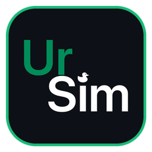
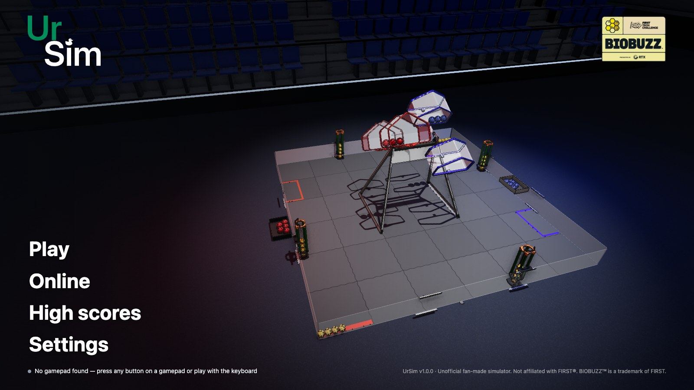
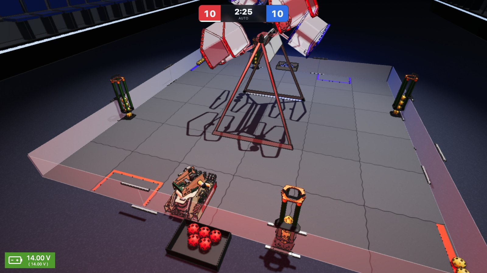
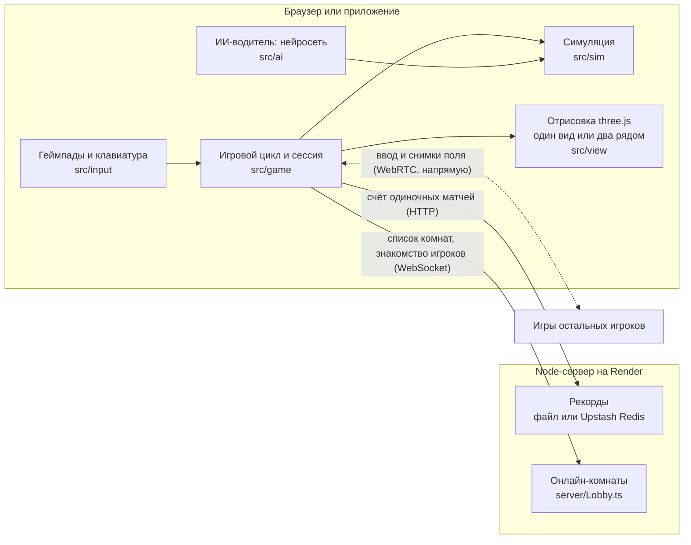

<p align="center"></p>

<h1 align="center">UrSim</h1>

<p align="center">Симулятор FIRST Tech Challenge сезона 2026–2027 <b>BIOBUZZ</b> от команды <b>URAN92</b></p>

<p align="center"><a href="../../releases/latest"><b>⬇ Скачать последнюю версию</b></a> · <a href="https://ursim.onrender.com">Играть в браузере</a> · <a href="README.md">English</a></p>



Водишь робота **URAN V2**, **Bumble V**, **Silver Bullet Blaster**, **Sirius Shadow**, **Bobik**, **Ri3D**, **Mechatronics** или **DHB** (мекан-шасси, автоматическая турель, интейк и шутер) по полю BIOBUZZ: собираешь POLLEN, переворачиваешь улей, играешь «Матч 2:30» с подсчётом очков и судьёй по мануалу или тренируешься без таймера. С двумя геймпадами можно играть вдвоём на одном компьютере, **экран делится пополам**: у каждого свой робот и своя камера. Одному — против **ИИ**, нейросети, обученной в симуляторе: 1 на 1 или 2 на 2 с ИИ-напарником, **лёгкий, средний или сложный**; вдвоём на разделённом экране можно играть против него одной командой. **Онлайн** — 1 на 1 или 2 на 2 в комнатах, открытых или закрытых паролем. Есть таблица рекордов для каждого робота. Интерфейс на русском, английском и казахском.



## Скачать

Все версии лежат на странице [Releases](../../releases). Выбери архив под свою систему:

| Система | Файл |
|---|---|
| Windows 10 / 11 (64-бит) | `UrSim_<версия>_Windows.zip` |
| macOS 12+ (Intel и Apple Silicon) | `UrSim_<версия>_Mac.zip` |
| Linux (64-бит) | `UrSim_<версия>_Linux.zip` |

Без установки можно играть в браузере: **https://ursim.onrender.com** (Chrome, Edge, Firefox, Safari). У приложения и сайта общая таблица рекордов.

### Как запустить

**Windows.** Распакуй архив (правый клик → «Извлечь всё») и запусти `UrSim.exe`. Если появится «Windows защитила ваш компьютер», нажми «Подробнее» → «Выполнить в любом случае»: у игры нет платной подписи Microsoft.

**macOS.** Распакуй архив и перетащи `UrSim` в «Программы». При первом запуске нажми на `UrSim` правой кнопкой → «Открыть» → «Открыть» (у игры нет подписи Apple). Если macOS пишет, что приложение «повреждено» или его «не удаётся проверить», открой Терминал и выполни:

```bash
xattr -cr /Applications/UrSim.app
```

**Linux.** Распакуй архив и запусти `./ursim` из распакованной папки. Если приложение сразу закрывается с ошибкой про sandbox (бывает на Ubuntu 24.04 и новее), выполни один раз в этой папке:

```bash
sudo chown root:root chrome-sandbox && sudo chmod 4755 chrome-sandbox
```

`F11` — полный экран. Любой геймпад (Xbox, PlayStation, Nintendo Switch, Logitech, 8BitDo и другие) или клавиатура, см. [Управление](#управление-как-в-ftc-teleop-по-умолчанию). Если игра тормозит, поставь в **Настройки → Графика** качество «Низкое» и выключи тени.

## Как устроено



**Симуляция без графики.** Вся логика игры лежит в `src/sim` и не зависит от графики: физика Rapier с шагом 120 Гц, меканум-шасси, механизмы, ульи, подсчёт очков и судья. Она работает в браузере, а отрисовка только показывает то состояние мира, которое отдаёт симуляция, смешанное между двумя последними шагами физики по времени, прошедшему с последнего (`src/game/Session.ts`): роботы движутся ровно при любом FPS, хоть 30, хоть 75, хоть 144, и игра идёт в реальном времени вплоть до 10 FPS.

**Экран пополам.** С двумя геймпадами в сессии два робота, и у каждого свой геймпад. Сцена рисуется в левую и правую половину одного холста (viewport и scissor) через две камеры, у каждой половины своя цепочка постобработки, а карта теней рисуется один раз за кадр на обе.

**Из CAD в игру.** Поле, ульи и игровые элементы переводятся скриптами из `tools/` из официального CAD BIOBUZZ (STEP → GLB), а коллизии поля запекаются в один бинарный файл, который читает браузер. Робот взят из CAD команды: в JSON-файле отмечено, какие детали крутятся (колёса, интейк, маховик, турель) и вокруг какой оси. Потом модель упрощается, а детали сливаются по материалам, чтобы было меньше вызовов отрисовки.

**Физика робота.** Кинематика меканума как в FTC TeleOp (относительно робота или поля по IMU). Скорость моторов зависит от модели аккумулятора: 14 В в начале матча, маховик его садит, под нагрузкой напряжение проседает. Турель сама наводится в пределах, которые позволяют провода (URAN V2 ±200°, Bumble V, Silver Bullet Blaster и Sirius Shadow пол-оборота в каждую сторону: все 360°, Bobik, Ri3D, Mechatronics и DHB 135° в каждую сторону) и разворачивается обратно через перед. Скорость маховика считается по баллистике для расстояния до ячейки улья, а разброс растёт с дальностью. Мячи вылетают из шутера с тем же вращением, что у команды (`shooter.spin`): у URAN V2 и Sirius Shadow с фронтспином, у Silver Bullet Blaster со слабым (ролики капота крутятся вместе с мячом), у Bumble V, Bobik, Ri3D и DHB без вращения (два колеса сжимают мяч одинаково), у Mechatronics с обратным (мяч катится по капоту над маховиком). Вращающийся мяч в полёте уводит в сторону (сила Магнуса, коэффициент подъёма S / (2S + 1) от параметра вращения S = rω / v: для POLLEN на 5 м/с около двадцатой доли g), а при отскоке его подбрасывает вперёд; автоприцел это учитывает, поэтому мяч с фронтспином летит чуть быстрее и входит в ячейку круче, а с обратным — медленнее.

**Автоматический судья.** Шесть правил из мануала проверяются по контактам в физике и состоянию матча. Прижатие (G421) определяется по углам робота, прижатого к стенке или элементу поля дольше 3 секунд, таран улья (G417) — по скорости удара о его раму. Фолы идут в счёт соперника, вторая жёлтая карточка становится красной, а все нарушения видны на табло после матча.

**Графика.** three.js с цепочкой постобработки: затенение (GTAO) в половинном разрешении и чёрные контуры фильтром Собеля по нормалям и глубине, плюс прожекторы и туман для вида арены. Края сглаживает FXAA, а не лишние пиксели, а если FPS падает ниже 50, качество само снижает разрешение и эффекты. Слияние статичных мешей сократило число вызовов отрисовки примерно с 650 до 370 за кадр, а упрощение моделей — число треугольников за кадр примерно с 2 млн до 0,7 млн. Робот дальше 2,4 м от камеры показывается облегчённой моделью (в 5–6 раз меньше треугольников): кадр 2 на 2 похудел с 1,77 до 0,56 млн треугольников, а видеокарте стало примерно в 1,5 раза легче. Модели роботов собираются из CAD команды по деталям (`tools/convert-robot.mjs`): 140–210 тыс. треугольников в полной и 25–34 тыс. в облегчённой, у механизмов крутятся все валы, шкивы и шестерни, меканум-колёса аккуратные, а шлифованный алюминий отражает зал сильнее, чем поле. Зал рисуется один раз, без прохода для контуров и затенения.

**Приложение и CI.** Та же сборка работает в Electron через свой протокол `app://`, поэтому fetch, WebAssembly и localStorage работают как на сайте. GitHub Actions собирает zip для Windows, macOS (universal) и Linux на машинах с этими системами.

**Онлайн.** Матч считает браузер админа комнаты, остальные подключаются к нему напрямую по WebRTC: шлют ввод и получают компактные двоичные снимки поля 60 раз в секунду по каналу, который не ждёт потерянных пакетов; сервер только хранит список комнат (см. [Онлайн](#онлайн)).

**Тесты.** 267 тестов на Vitest в 30 файлах: симуляция (очки, переворот улья, аккумулятор, трансфер, защита), стартовые позиции по G304, правила судьи и настройки правил, ИИ-водитель и его уровни, онлайн-комнаты и сетевая игра, повторы, назначение кнопок, рекорды и переводы.

| Область | Инструменты |
|---|---|
| Язык | TypeScript (около 11 900 строк в `src/` и `server/`) |
| 3D-графика | three.js |
| Физика | Rapier (WebAssembly) |
| Сборка | Vite, esbuild |
| Сервер | Node.js (файлы игры, рекорды и список онлайн-комнат), хостинг Render |
| Приложение | Electron, electron-builder, GitHub Actions |
| Тесты | Vitest |

## Запуск из исходников

```bash
npm install
npm run dev
```

Открыть http://localhost:5173. Подключить любой геймпад и нажать любую кнопку.

## Роботы

Перед матчем или тренировкой открывается выбор робота: альянс, камера и режим управления, а рядом карточка с характеристиками робота (рапид-файр, масса, привод, скорость, турель, вес маховика и скорость мотора интейка, если команда их дала, что берёт, Flower Mode, вращение мяча). Робот, которого две команды собрали по одному CAD, — на одной карточке: у Ri3D (Robot in 3 Days команды WXYZ, по CAD которого RoboRangers собрали Bobik) логотип WXYZ, а в углу — RoboRangers, и кнопка **Сменить на RoboRangers** / **Сменить на WXYZ** рядом с названием меняет модель (характеристики одинаковые). Карточка помнит, какой выбран последним, а таблица рекордов у каждого своя (`basedOn` в `src/robot/robots.ts`). Если подключён второй геймпад, там же появляются строки для робота и альянса gamepad2 (см. [Экран пополам](#экран-пополам)).

**Стартовая позиция.** В строке «Старт. позиция» (и в онлайн-комнате) поле открывается сверху, своя стенка внизу. Левый стик (или WASD, или мышь) двигает робота, правый стик (Q / E, колесо мыши) поворачивает; стенки и центральная линия его останавливают, при повороте он не отрывается от стенки, а около 45° и 90° встаёт ровно. Подсветка зелёная, если по правилу G304 здесь можно стартовать: робот целиком на своей половине, касается стенки, не касается FLOWER, не стоит в LOADING ZONE и на POLLEN из GARDEN и не наезжает на робота партнёра; иначе красная, с причиной. Сохранить (Ⓐ / Enter) запоминает позицию для этого робота, Стандартная (Ⓨ / R) возвращает обычное место у стенки альянса, Отмена (Ⓑ / Esc) ничего не меняет. Позиция хранится как для красной стороны, за синих робот встаёт так же, повёрнутый вокруг центра поля. Если позиция в игре всё-таки занята, робот встаёт на обычное место (`src/field/startPose.ts`, `src/ui/StartPositionScreen.ts`).

- **URAN V2** (команда URAN92; заменил URAN V1): модель из CAD команды, mecanum на моторах 518 RPM с колёсами 82 мм (≈2,2 м/с), 9 кг, 44 × 32 см (53 см с опущенной рукой). Рапид-файр: все 4 мяча за 0,2 с, а интейк берёт мяч каждые 0,175 с, в два раза быстрее других роботов.
- Турель сама поворачивается к цели; колёса, интейк, трансфер и маховик крутятся как на настоящем роботе.
- Точность шутера зависит от расстояния до ячейки: до 1 м — почти всегда попадает, к 2,2 м — сильный разброс.
- Защита: если два робота врезаются друг в друга быстрее 0,7 м/с, турели обоих сбиваются на 2 с, и даже вблизи попадает только примерно 3 мяча из 4.
- С поднятой рукой захват URAN V2 не достаёт мячи из цветов. Flower Mode: П-образная рука перед интейком (push back), как у Bumble V.
- URAN V2 берёт и бросает только POLLEN, через NECTAR просто проезжает (`intakes` в `src/robot/robots.ts`).
- **Bumble V** (команда SWB): модель из CAD команды, mecanum на моторах 522 RPM с колёсами 96 мм (≈2,6 м/с), 11 кг, 46 × 28 см. Шутер с двумя маховиками на турели, которая поворачивается на пол-оборота в каждую сторону (всего 360°). Берёт и бросает только POLLEN. Рапид-файр: 4 мяча за 0,7 с. Передняя рука (Flower Mode): опущенная у цветка, выталкивает POLLEN снизу в push back. Если опустить её вплотную к цветку, бортику или роботу, она опускается, пока не упрётся, и лежит на препятствии, а когда робот отъезжает, опускается до конца.
- **Silver Bullet Blaster** (команда SWB): модель из CAD команды, mecanum на моторах 435 RPM с колёсами 104 мм (≈2,4 м/с), 12,5 кг, 42 × 37 см (55 см с опущенной рукой). Берёт и POLLEN, и NECTAR, и у него **две турели**, у каждой свой канал: левая стреляет POLLEN, правая — NECTAR, обе одновременно. Рапид-файр: 4 мяча за 1 с. Flower Mode как у Bumble V: П-образная рука на передней оси интейка, поднимается сервой с катушкой; опущенная, не берёт мячи с пола, но выталкивает POLLEN из цветка в push back.
- **Sirius Shadow** (команда Mooneye): модель из CAD команды, mecanum на моторах 518 RPM с колёсами 104 мм (2,82 м/с в теории, 2,4–2,5 м/с на поле), 9 кг, 38 × 30 см (41 см до передних колёс интейка). Берёт и POLLEN, и NECTAR, и у него **две турели** одна за другой, каждая поворачивается на пол-оборота в каждую сторону (все 360°): задняя стреляет POLLEN, передняя — NECTAR. Интейк сортирует мячи по размеру: за колёсами Moosetake NECTAR не проходит между двумя направляющими и поднимается по ним в переднюю турель, а POLLEN проваливается между ними на рампу, которая везёт его назад и вверх в заднюю турель. По углам спереди стоят gecko-колёса, которые заворачивают мячи внутрь, поэтому он берёт мячи по всей ширине фронта, но не сбоку (`intakeHalfWidth`). Рапид-файр: 4 мяча за 0,4 с. Flower Mode нет.
- **Ri3D** (команда WXYZ, 19705) и **Bobik** (команда RoboRangers, 25590): один робот на одной карточке. WXYZ сделали его за свой Robot in 3 Days сезона 2026–27, а RoboRangers собрали Bobik по их CAD; сзади у Bobik закрытые панели, а у WXYZ — четыре линейных слайдера (44 см в высоту, Bobik 37 см). Обе модели — из CAD команд, и обе играют с характеристиками WXYZ: mecanum на 435 RPM с колёсами 104 мм (≈2,4 м/с), 9 кг, рама-короб 36 × 33 см с интейком на 6 см впереди (51 см с опущенной рукой). Одна турель, поворачивается на 135° в каждую сторону (всего 270°): маховик снизу спереди и ролик сверху сзади сжимают мяч, когда он поднимается через кольцо турели, поэтому он летит без вращения. Четыре вала роликов на одном моторе 2000 RPM везут мячи под собой вверх по каналу шириной 7,4 см: только POLLEN, мяч каждые 0,2 с. Рапид-файр: 4 мяча за 0,3 с. Flower Mode: две боковые пластины на передних углах рамы и пластина поперёк их концов. Поднятая рука стоит перед интейком так высоко, что мячи прокатываются под ней, но в стену и роботов она упирается (`arm.raisedBox`); опущенная на 50°, пластина лежит в 2–4 см над полом, и POLLEN, вытащенный из FLOWER, ждёт на ней (`arm.pocketLift`).
- **Mechatronics** (команда 13368): модель из CAD команды, mecanum на ~500 RPM с колёсами 104 мм (≈2,7 м/с), рама 39 × 29 см, гибкие звёзды интейка на 4 см впереди. Одна турель на кольцевом подшипнике, её поворачивают два сервопривода на 135° в каждую сторону (всего 270°). Маховик — колесо 72 мм спереди турели с мотором с каждой стороны, утяжелённое до 800 г: мяч поднимается за ним по регулируемому капоту и вылетает вперёд через верх, катясь по капоту, поэтому летит с обратным вращением. Тяжёлый маховик раскручивается примерно в 2,7 раза медленнее обычного (около секунды вместо 0,4 с), зато каждый выстрел отнимает у него около 4% скорости вместо 10% (`shooter.flywheelMass`). Мячи берут три гибкие звезды и векторное колесо на каждом конце переднего вала, а мягкие колёса везут их вверх по изогнутой рампе и через кольцо турели: только POLLEN. Flower Mode нет. Вес и рапид-файр команда не дала: 11 кг и 4 мяча за 0,5 с — оценка.
- **DHB** (команда MLP, 19163): модель из CAD команды, mecanum на 611 RPM с колёсами 104 мм, каждое крутит свой мотор через косозубую передачу 11:110: 3,3 м/с, самый быстрый робот в игре. 11,5 кг, рама 32 × 30 см, интейк на 8 см впереди и направляющие по углам, которые заворачивают мячи внутрь (49 см с опущенной рукой). Одна турель на кольцевой шестерне на 79 зубьев, её поворачивают два сервопривода через шестерню сзади на 135° в каждую сторону (всего 270°); flex-колесо 3″ снизу спереди и три flex-колеса 1,625″ сверху сзади, каждое на своём моторе, сжимают мяч, когда он поднимается через кольцо, поэтому он летит без вращения. Мячи берёт вал с колёсами 72 мм по всей ширине, а другие ролики везут их по изогнутой рампе из двух рельсов, которая загибается вверх в кольцо турели: канал шириной 7,6 см, только POLLEN. Мотор интейка — 1800 RPM: мяч каждые 0,22 с. Рапид-файр: 4 мяча за 0,5 с. Flower Mode: П-образная рука push back на переднем валу интейка, её поднимают два сервопривода; поднятая, она откидывается назад над интейком, а опущенная лежит поперечной пластиной в 1–3 см над полом, и POLLEN, вытащенный из FLOWER, ждёт на ней.

**Push back (Flower Mode: URAN V2, Bumble V, Silver Bullet Blaster, Bobik, Ri3D и DHB).** Опущенная рука блокирует пол. Когда её передняя планка заходит в нижний проём FLOWER (под среднее кольцо, до стойки у стенки), она выталкивает нижний POLLEN назад — в push back, между планкой и роликами интейка. Мяч лежит там и едет вместе с роботом, пока не включишь интейк (или трансфер); тогда ролики хватают его, а следующий выталкивается, как только сам упадёт на дно, — FLOWER пустеет с той скоростью, с какой падают мячи (около 0,15 с на мяч, как блоки в трубе-лоадере VEX), пока у робота не станет 4 мяча (G407). Если въехать во FLOWER с разгона (быстрее 0,4 м/с), мячи в трубе подпрыгивают и следующий выходит, только когда они снова лягут. Если поднять руку, мяч остаётся на полу перед интейком. Опущенная рука у всех низкая (до 9 см, как в CAD), поэтому планка заходит под среднее кольцо. ИИ сам включает интейк, когда в push back мяч, не поднимает руку, пока его не заберёт, и отъезжает, если рука упёрлась и не опускается.

Как добавить робота из CAD (STEP):

```bash
pip install cascadio==0.1.1 numpy
python3 -c "import cascadio; cascadio.step_to_glb('Robots/Uran 92 V2/Jedi92.step', 'robot-raw.glb', tol_linear=0.25, tol_angular=0.2, include_materials=True)"
node tools/convert-robot.mjs robot-raw.glb public/assets/robots/uran-v2.glb tools/robots/uran-v2.json public/assets/robots/uran-v2-low.glb
```

В `tools/robots/uran-v2.json` (и остальных) описано, какая ось CAD смотрит вверх (`up`: Fusion выгружает +y или +z) и вперёд, какие сборки выкинуть (`drop`), и подвижные части робота: какие детали CAD — турель, маховики, валы интейка и трансфера, колёса, и вокруг какой оси они крутятся (`reverse` — в другую сторону). В `fixed` перечислены детали, которые не двигаются, даже если стоят рядом с крутящейся (например, ремни вокруг шкивов колёс); `detail` и `lowDetail` задают, на сколько метров может сдвинуться поверхность детали при упрощении в полной и облегчённой модели (каждая деталь CAD упрощается отдельно, поэтому пластины не теряют толщину, а круглое остаётся круглым), а `translucent` — цвета прозрачных панелей из CAD, которые надо показать прозрачными (STEP теряет прозрачность), или их имена в CAD (`name`), если такого же цвета и непрозрачные детали. В модели игры рука лежит опущенной: если в CAD она поднята, `turn` (рад вокруг её оси; отрицательный опускает передний конец) записывает её повёрнутой на этот угол. Конвертер ещё выкидывает детали, которых не видно ни с какой стороны и ни сверху, крутит вместе с роликом, колесом или маховиком всё, что стоит на его оси (валы, шкивы, шестерни, ступицы; `coaxial: false` это отключает), и пересобирает колесо с `mecanum: true` в аккуратное меканум-колесо того же размера и цветов, ролики которого наклонены как в CAD (`mecanum.slant` задаёт наклон, если в CAD колесо не той руки, `mecanum.match` — имя сборки колеса). Ступени лифта задают `slide` (насколько поднимаются, м; что на них едет, ссылается на них через `parent`), и конвертер оставляет всё, что видно хотя бы в одном положении, внизу или вверху; `swing` (рад) — на сколько игра поворачивает деталь на угол (регулируемый капот шутера, стопор коробки); `colorTolerance` сливает почти одинаковые цвета CAD в один материал, чтобы было меньше вызовов отрисовки; `split` называет узлы CAD, в одной сетке которых несколько тел (безымянное тело STEP, как у DHB кольцевая шестерня турели, слитая с ведущей шестернёй), чтобы каждый кусок нашёл своё правило. Для нового робота скопируй этот файл и поправь узлы и оси под его CAD, потом добавь робота в `src/robot/robots.ts`: размеры, мотор, колёса, вес, шутер (и насколько поворачивается турель), где лежат мячи внутри (`storage`: по месту на каждый мяч вдоль пути мяча в CAD, от шутера назад до рта интейка), логотип команды в `public/assets/teams/`; для складной руки `node tools/arm-reach.mjs <model.glb> <upAngle>` измеряет `arm.reach`. Файл Fusion 360 `.f3z` без Fusion не прочитать: выгрузи его в STEP с галочкой «Save to my computer».

## Мастерская: свои роботы

**Мастерская** в главном меню (или карточка «+ Свой робот» при выборе робота) — роботы, которых делаешь сам. Они играют во всех режимах: матч, тренировка, экран пополам, против ИИ (ИИ тоже умеет ими управлять) и онлайн. В таблицы рекордов они не попадают: иначе любой собрал бы самого быстрого робота на свете.

- **Собрать из блоков**: простая модель из блоков (шасси с четырьмя колёсами, интейки с роликами, турели на стойках с маховиками и, если нужно, рука Flower Mode) в двух цветах на выбор. Каждое изменение сразу видно на роботе на поле; поле можно вращать мышью, колесо — приближение. Вкладки задают, что робот умеет: название, команда и номер (на табличках); шасси (длина и ширина в пределах стартового куба FTC в 18 дюймов, высота рамы, тип привода, колёса 60–140 мм, обороты моторов, масса; не быстрее 3,2 м/с); интейки; турели. Подвижные части крутятся как у командных роботов: колёса, swerve-модули, ролики интейков, маховики, турели, рука.
  - **Привод**: mecanum (в любую сторону, вбок на 15% медленнее), swerve (каждое колесо поворачивается: полная скорость в любую сторону, разворот чуть медленнее) или танк (обычные колёса в гусеницах: вбок не ездит, зато сцепление на 25% лучше — быстрее разгоняется и сильнее толкает; ИИ разворачивает его туда, куда едет).
  - **Интейки**: передний и, если нужно, второй сзади — чтобы собирать мячи, двигаясь в обе стороны. Каждый берёт POLLEN, NECTAR или оба, со своей шириной, выносом из рамы и скоростью; оба крутятся от одной кнопки, выплёвывает передний. Рука Flower Mode стоит перед передним интейком. ИИ собирает передним.
  - **Турели**: от 1 до 5, у каждой свои настройки: чем стреляет (любыми мячами или только POLLEN или NECTAR — у каждой своя полоса, как у Silver Bullet Blaster), где стоит на раме, высота вылета мяча, куда смотрит в покое и насколько оттуда поворачивается (0 — неподвижная, целишься роботом), рапид-файр и вращение мяча. «+» добавляет турель как выбранную и ровно расставляет её с остальными (или ставит туда, где больше места, если ты их двигал); с многими помогают «Всем турелям так же» и «Расставить ровно». Стреляют вместе, каждая своим мячом, и каждый маховик сажает батарею. Первая — главная, её выстрелы показывает HUD. Для каждого мяча, который робот может держать, есть турель, которая его стреляет: Мастерская не даст оставить мяч без турели.
- **Загрузить 3D-модель** своего робота из CAD: GLB, glTF (одним файлом), OBJ или STL, до 2,5 млн треугольников. Единицы игра определяет по размеру (мм, см, дюймы или метры — можно поменять), ось «вверх» — по типу файла (Y у glTF и OBJ, Z у STL — тоже меняется), и поворачивает модель передом вперёд по 90°. Модель без своих цветов красится в цвет рамы. Размеры робота берутся с модели; как он ездит и стреляет, задают те же вкладки, что у блоков. Рамки на поле показывают, как модель сидит: рамка — чем робот сталкивается, зелёное — где интейк берёт мячи, оранжевое — откуда они вылетают, жёлтое — опущенная рука. Загруженная модель видна только на твоём компьютере: онлайн другие игроки видят робота блоками.
- **Тест-драйв** сохраняет робота и запускает с ним тренировку; «В главное меню» из паузы возвращает в его редактор.
- **Поделиться**: «Сохранить файл» записывает файл `.ursimbot` с роботом и его 3D-моделью; «Скопировать код» даёт короткий текст `URSIM-ROBOT:…` для чата (только блоки, без модели). «Открыть файл робота» или вставленный код добавляют робота к твоим; «Копия» — дубликат, чтобы что-то поменять.
- **Онлайн** свой робот уходит в комнату чертежом: игра админа его симулирует, а все его видят (блоками). Сервер проверяет его теми же ограничениями (`server/Lobby.ts`).
- **Галерея**: вкладка «Галерея» в Мастерской — роботы, которых выложили игроки, новые или самые добавляемые первыми, с поиском по названию, команде и автору. Выбранный робот появляется на поле (3D-модель подгружается сама до 8 МБ, больше — по кнопке); «Добавить к моим» делает его твоим, «Тест-драйв» — ещё и сразу запускает. Чтобы выкладывать, нужен аккаунт (на сайте): «Выложить в галерею» отправляет туда робота с картинкой и 3D-моделью (до 25 МБ) под твоим ником; повторная публикация обновляет его, «Убрать из галереи» — убирает (у тех, кто его добавил, он остаётся). У каждого там до 20 роботов. Робот, на которого пожаловались 3 вошедших игрока, скрывается, пока его не проверит модератор: модераторы задаются на сервере в `GALLERY_ADMINS` (ники через запятую, например в `/etc/ursim.env`), они могут убрать любого робота и вернуть скрытого. Сервер хранит список в своей базе, а картинки и модели — файлами рядом с ней (`GALLERY_DIR` переносит их; `server/Gallery.ts`, `src/net/galleryProtocol.ts`).

Свои роботы хранятся в браузере (список — в localStorage, 3D-файлы — в IndexedDB), а пока ты вошёл в аккаунт — ещё и в аккаунте (до 50 роботов и 250 МБ моделей): войдёшь на другом компьютере — они там. Побеждает самая новая версия робота, а удалённый на одном компьютере пропадает и на остальных; роботы, сделанные без входа, достаются аккаунту, который войдёт следующим (`server/AccountRobots.ts`, `src/net/robotSync.ts`). Код: `src/robot/custom.ts` (чертёж, его ограничения и робот из него), `src/robot/customStore.ts` (хранение и обмен), `src/view/customModel.ts` (модель из блоков, чтение и подгонка 3D-файлов, картинки для карточек), `src/ui/Workshop.ts` (экран).

## Режимы

Каждая игра начинается с отсчёта 3-2-1 на экране: поле, таймер и роботы ждут его.

- **Матч 2:30** — как на соревнованиях: 3-2-1 → АВТОНОМ 30 с → переход 8 с («Drivers, pick up your controllers» 5 с, потом 3-2-1) → TELEOP 2:00 (последние 30 с — END GAME), подсчёт очков по мануалу, в конце — анимация сезона RED WINS! / BLUE WINS!, а за ней экран результатов как на настоящих соревнованиях FTC (R — ещё раз, Esc — в меню; эти клавиши, Enter и пробел пропускают анимацию, а при ничьей результаты появляются сразу): блок WINNER, строки LEAVE & PARK, HIVE, FLOWER, GARDEN и FOUL, у каждой команды — место в рейтинге матчей, сыгранных с открытия страницы, заработанные Ranking Points (WIN 3, TIE 1, SWARM — от 16 очков LEAVE + PARK, POLLINATOR 1 и 2 — от 4 и 7 TIPS, таблица 10-3 мануала), а под каждым альянсом — какие роботы стояли в его LOADING ZONE в конце AUTO и в конце матча (по 5 очков, мануал 10.5). В «Настройки → Интерфейс» выбирается, как видно счёт во время матча: целиком в реальном времени, только свои очки и за что (фолы и карточки — на экране результатов) или вообще только в конце. На поле LOADING ZONE обведена лентой и слегка залита цветом альянса, а в последние 8 с AUTO и 15 с матча заливка пульсирует. Автонома пока нет: в эти 30 секунд управляешь сам.
  Звуки — запись настоящего таймера поля FTC, а его табло идёт на одном экране у дальнего края поля (красные драйверы видят его слева, синие справа) (`src/game/matchTimer.ts`, `src/view/TimerScreens.ts`). Ведут часы игры, запись идёт за ними и встаёт на паузе. Часы игры теряют время на медленных кадрах, и запись убегает вперёд: тогда она чуть замедляется или молча ждёт игру, но назад не перематывается, поэтому фразы вроде «Drivers, pick up your controllers» не звучат дважды; отставшая больше чем на 0,5 с запись перескакивает вперёд, а в фоновой вкладке встаёт вместе с игрой. Табло сверху в матче показывает только очки.
- **Тренировка** — без таймера, очки и перевороты считаются.
- **Экран пополам** — любой из двух режимов выше вдвоём с двумя геймпадами: у каждого свой робот и своя половина экрана.
- **С ИИ** — любой из двух режимов выше с роботами, которыми управляет нейросеть (лёгкий, средний или сложный уровень): 1 на 1 против одного или 2 на 2 с ИИ-напарником против двух; на разделённом экране ИИ занимает свободные места водителей (см. [Соперник-ИИ](#соперник-ии)).
- **Онлайн** — «Матч 2:30» или бесконечная тренировка в комнате, 1 на 1 или 2 на 2, с ИИ на любом свободном месте (см. [Онлайн](#онлайн)).

Мяч, вылетевший за поле, через 5 секунд возвращается (мануал 10.8.2): POLLEN кладётся на поле у ближайшей стенки, NECTAR отдаётся человеку-игроку своего альянса, и тот может сразу ввести его снова (G427).

Во время игры на экране только таймер со счётом и аккумулятор робота, как на Driver Station: зелёный блок с напряжением сейчас и самым низким за матч в скобках. В начале матча 14 В; маховик, который крутится без остановки, садит аккумулятор, и робот едет медленнее (скорость моторов пропорциональна напряжению). На разделённом экране в каждой половине свой геймпад, место водителя и аккумулятор.

Турель не крутится бесконечно (мешают провода): у URAN V2 она поворачивается не больше чем на 200° в каждую сторону (у Bumble V, Silver Bullet Blaster и Sirius Shadow на пол-оборота: все 360°, у Bobik, Ri3D, Mechatronics и DHB на 135°, всего 270°), а если цель уходит дальше, турель разворачивается обратно через перед.

Камера выбирается перед игрой: **вид водителя**, **вид зрителей** (с трибуны) или **за роботом**. Во время матча камеру менять нельзя; только «за роботом» по R3 смотрит вперёд или назад (камера не поворачивается вместе с роботом, а едет за ним).

## Правила и судья

В «Матч 2:30» судья сам следит за правилами из мануала (раздел 11.4). MINOR FOUL даёт сопернику 5 очков, MAJOR FOUL — 20 (строка FOUL на табло), вторая жёлтая карточка становится красной — 0 очков за матч. Все нарушения перечислены на табло после матча.

| Правило | Что нельзя | Наказание |
|---|---|---|
| G402 | В AUTO брать мячи или толкать робота соперника на его половине поля | MAJOR FOUL за матч |
| G405 | Выбрасывать мяч за поле (промах при броске не считается) | MAJOR FOUL за мяч |
| G408 | Брать NECTAR соперника | предупреждение, потом жёлтая карточка |
| G410 | Забрасывать NECTAR в цветок раньше последней минуты | MAJOR FOUL за NECTAR |
| G417 | Таранить раму улья (быстро или дважды за 10 с) | предупреждение, потом MAJOR FOUL и жёлтая |
| G421 | Прижимать соперника к стенке или элементу поля дольше 3 с | MAJOR FOUL и ещё один каждые 3 с |

Остальные правила симулятор просто не даёт нарушить: роботы стоят между периодами и после матча (G403, G404), в робота помещается максимум 4 мяча (G407), интейк берёт мячи только с пола (G409) и не достаёт из цветка (G418), а человек-игрок вводит NECTAR по правилам (G426–G428). Правила про людей, инспекцию и «намеренность» на усмотрение судьи в симуляторе не проверяются. В тренировке судьи нет.

## Рекорды

«Рекорды → Таблица» в главном меню — топ 100 за период: сезон FTC (с сентября по август; первый — BIOBUZZ 2026–27) или один из его месяцев. **Рекорды · Соло** — матчи 2:30 в одиночку без ИИ, для каждого робота или для всех вместе («Все»); **Дуо** — матчи на разделённом экране, оба робота в одном альянсе. У игрока одна строчка: новый лучший счёт заменяет старый. Вошедшие игроки видны со своим @ником (строчка открывает их карьеру), гость — по имени, вписанному в «Рекордах» или на экране выбора робота. **Рейтинг** — онлайн-лестница (см. «Аккаунты» ниже). Старые версии игры по-прежнему показывают таблицу каждого робота за всё время (`/api/records`), соло-матчи идут и туда. Свои роботы из [Мастерской](#мастерская-свои-роботы) ни в какие таблицы не попадают.

Рекорды хранит сервер. Без настроек он пишет их в файл `data/records.json`, но бесплатный Render стирает диск при каждом перезапуске, поэтому для сайта нужна бесплатная база [Upstash Redis](https://upstash.com):

1. Войди на upstash.com (можно через GitHub) → **Create Database** → тип Redis, регион Frankfurt, план Free.
2. На странице базы во вкладке **REST API** скопируй `UPSTASH_REDIS_REST_URL` и `UPSTASH_REDIS_REST_TOKEN`.
3. В Render: сервис `ursim` → **Environment** → **Add Environment Variable** → добавь обе переменные с этими значениями → **Save Changes**.

После перезапуска в логе сервера будет `High scores: upstash`, а `https://<адрес>/health` покажет `"records": "upstash"` (`"file"` значит, что при следующем перезапуске таблицы пропадут).

Даже без базы таблицы возвращаются после перезапуска, только не так надёжно. Каждый браузер хранит копию всех таблиц, которые видел, и свои лучшие результаты, и отправляет перезапущенному серверу потерянные строки вместе с датами (при запуске игры и при открытии «Рекордов»). При обновлении новый сервер ещё и забирает таблицы у старого, пока тот отвечает. Рекорд, который до перезапуска не видел ни один другой браузер, вернётся, только когда снова зайдёт его автор, поэтому для полной сохранности всё равно нужна база.

Сервер рекордов у себя рядом с игрой (два терминала):

```bash
npm run dev
```

```bash
npm run server
```

Готовая сборка — это один процесс, который отдаёт и игру, и рекорды:

```bash
npm run build && npm run build:server && PORT=8787 npm start
```

Другой сервер рекордов можно выбрать ссылкой `?server=https://…`.

## Аккаунты, статистика и друзья

В главном меню видно, сколько игроков когда-либо сыграли (вошедшие считаются по аккаунту, гости — по браузеру), сколько всего аккаунтов, сколько сыграно игр (Соло — один игрок, в том числе против ИИ; Дуо — экран пополам; 1 на 1 и 2 на 2 — онлайн-комнаты; Тренировка — от 20 с) и сколько из них с аккаунтом (аккаунты и такие игры, появившиеся до того, как сервер начал их считать, он досчитывает один раз при запуске, по истории матчей), сколько человек сейчас в игре (`● 4 в сети · 3 с аккаунтом`, через маленький WebSocket `/presence`, который держит каждая открытая игра), ссылки на Instagram и GitHub и кнопка **Скачать** для версии на компьютер.

**Вход через Google** или **по почте с паролем** (кнопка справа вверху) создаёт аккаунт с уникальным @ником (меняется в «Рекорды → Карьера → Изменить»). У вошедших есть **«Рекорды → Карьера»**: сыгранные игры, процент побед, время в игре, лучший счёт и рейтинг за период или за всё время и история матчей (последние 200 игр) с фильтрами по режиму и исходу, а также **архив матчей**: последние 30 матчей («Матч 2:30» соло, на разделённом экране или онлайн), каждый можно пересмотреть.

**Повторы.** После любого матча V (Y на геймпаде) на экране результатов показывает его снова, даже без аккаунта; матчи вошедшего игрока ещё и попадают в архив (`server/Replays.ts`, около 2 МБ каждый в gzip, рядом с базой или в `REPLAYS_DIR`). Повтор идёт со скоростью 0,25–2×, с полосой времени, лучшими моментами (старт, залпы, перевороты HIVE, финиш) и восемью камерами: свободная (перетаскивание — повернуть, колесо — приблизить, правая кнопка — сдвинуть, WASD и Q / E — лететь, Shift — быстрее), облёт, режиссёр, сверху, водитель красных или синих, зрители и за роботом. В повторе «● Записать отсюда» сохраняет его в видео (см. [Студия повтора](#студия-повтора)). Esc — назад. Во время игры «▶ Смотреть демку» в меню паузы показывает её до этого момента: матч записывается сам, тренировка — после «● Начать запись» (в углу REC и время; «■ Остановить запись» оставляет её посмотреть до конца игры). Онлайн игра тем временем идёт дальше, твой робот стоит, запись тоже продолжается; ○ / B на геймпаде выходит из повтора. Карьера любого игрока открывается из его строчки в таблице. **Друзья** (вкладка у правого края): добавить игрока по @нику, принять или отклонить заявку, видеть, кто в сети и в какой он комнате, и войти в неё одной кнопкой.

**Рейтинг**: онлайн-матч 2:30, где каждым роботом управляет вошедший игрок (без ИИ и гостей), меняет рейтинг Эло каждого (все начинают с 1000, K = 32; в 2 на 2 считается средний рейтинг альянса) в лестнице сезона и месяца. Как закончился матч, сообщает игра админа комнаты; сервер засчитывает его один раз для всех в комнате.

Аккаунты, сессии, статистика, друзья и таблицы периодов хранятся так же, как рекорды: в `data/db.json` по умолчанию (`DB_FILE` переносит файл), в базе Upstash, если заданы её две переменные. **На бесплатном Render аккаунтам нужна Upstash**: без неё каждый перезапуск их стирает.

### Как включить вход через Google

Google возвращает игроков только на настоящий домен (из списка публичных суффиксов, не IP-адрес). VPS отвечает по адресу `https://2-135-146-200.sslip.io`; если в шаге 3 Google не примет этот адрес, сначала дай серверу бесплатное имя: создай `ursim` на [duckdns.org](https://www.duckdns.org) с адресом `2.135.146.200` (Caddy уже обслуживает `ursim.duckdns.org` и сам получит сертификат) и дальше используй `https://ursim.duckdns.org`.

1. Открой [Google Cloud Console](https://console.cloud.google.com/) → создай проект (например, `UrSim`).
2. **Google Auth Platform → Branding**: имя `UrSim`, почта поддержки, адрес игры → **Audience**: External → **Publish app** (в режиме Testing войти могут только указанные тестовые пользователи). Игра просит только `openid` и `profile` (имя игрока), без почты, поэтому проверка Google не нужна.
3. **Clients → Create client** → тип **Web application**:
   - Authorized redirect URIs: `https://<адрес игры>/auth/google/callback` и, для проверки на своём компьютере, `http://localhost:8787/auth/google/callback`
   - Authorized JavaScript origins можно оставить пустыми (вход делает сервер, а не страница).
4. Пропиши адрес игры и клиента в `/etc/ursim.env` на сервере и перезапусти его. Команда спрашивает секрет прямо на сервере, так что он не попадёт ни в чат, ни в файл на твоём компьютере:

   ```bash
   ssh -t ursim 'read -p "Client ID: " id; read -s -p "Client secret: " secret; echo; printf "PUBLIC_URL=https://2-135-146-200.sslip.io\nGOOGLE_CLIENT_ID=%s\nGOOGLE_CLIENT_SECRET=%s\n" "$id" "$secret" >> /etc/ursim.env; chmod 600 /etc/ursim.env; systemctl restart ursim'
   ```

   В логе (`ssh ursim journalctl -u ursim -n 10`) появится `Sign-in: e-mail, google`, а в игре — «Войти через Google». С именем DuckDNS `PUBLIC_URL` будет `https://ursim.duckdns.org`, а `AUTH_ORIGINS=https://2-135-146-200.sslip.io` оставит вход со старого адреса. На Render шаги те же, `GOOGLE_CLIENT_ID` и `GOOGLE_CLIENT_SECRET` — в **Environment** (адрес Render задаёт сам).

Первый вход через Google создаёт аккаунт и просит выбрать имя, которое видят другие, и @ник; они подставлены из Google (`Me.needsName`), поменять их потом можно в карьере. Версия для компьютера входит через браузер игрока и получает сессию обратно на 127.0.0.1 (`desktop/signin.cjs`, как велит RFC 8252 для приложений): внутри окна приложения Google входить не даёт.

**Вход по почте** не нужно настраивать: сервер хранит только scrypt-хеш пароля (`server/emailAuth.ts`), никому не показывает адрес, а после 10 неверных паролей адрес ждёт 15 минут. Сброса пароля по почте пока нет (сервер не отправляет письма).

Игра на другом адресе, которой можно входить через этот сервер, указывается в `AUTH_ORIGINS` (адреса через запятую). Для проверки без Google `AUTH_DEV_LOGIN=1 npm run server` добавляет тестовый вход по одному имени — на публичном сервере его включать нельзя.

Версия для Steam будет входить через Steam: ещё один способ входа в `server/auth.ts` (OpenID 2.0 на сайте, session ticket в игре на компьютере) к такому же аккаунту.

## Экран пополам

Подключи два любых геймпада и открой «Играть → Матч 2:30» или «Тренировка». На экране выбора робота появятся строки для gamepad2: **gamepad2 → Свой робот**, его робот и его альянс; gamepad1 выбирает робота карточками, как обычно. После «Старт» каждый едет своим роботом со своего геймпада на своей половине экрана: gamepad1 слева, gamepad2 справа, у каждого камера, выбранная перед игрой.

- Один альянс на двоих (Red 1 и Red 2 или Blue 1 и Blue 2) — играете командой; разные альянсы — 1 на 1.
- **ИИ** делает из этого 2 на 2: команде из двоих — два соперника-ИИ («2 соперника, 2 на 2»), а двоим в разных альянсах — по ИИ-напарнику («Напарник каждому, 2 на 2»), с выбранной «Сложностью ИИ» (см. [Соперник-ИИ](#соперник-ии)).
- Поставить паузу можно с любого геймпада. Клавиатура играет за gamepad1.
- Защита работает: если протаранить другого робота, турели обоих сбиваются на 2 с (см. [Роботы](#роботы)).
- **gamepad2 → Оператор (FTC)** оставляет одного робота на весь экран, а gamepad2 управляет его механизмами, как второй водитель в FTC.
- Какой геймпад gamepad1, а какой gamepad2: «Настройки → Геймпады → Поменять gamepad1 ↔ gamepad2».

## Онлайн

«Онлайн» в главном меню — комнаты, где ещё нужны игроки, 1 на 1 или 2 на 2. Напиши своё имя и войди в комнату или создай свою («Создать 1 на 1», «Создать 2 на 2»). Кто создал комнату, тот её админ (★):

- по умолчанию комната открыта, войти может любой. «Закрыть паролем» просит 4 английские буквы: в списке у комнаты появляется замок, и для входа нужны эти буквы (регистр не важен). «Открыть комнату» снимает пароль;
- «+ ИИ» на свободном месте ставит туда нейросеть — в свою команду или в соперники, «Робот ИИ ›» меняет её робота, «✕ Убрать ИИ» освобождает место. Так 2 на 2 можно играть одному с ИИ-напарником против двух ИИ, а когда придут люди, каждый зашедший (или нажавший «Встать сюда») займёт место ИИ. «Сложность ИИ» в правилах комнаты делает всех ИИ в ней лёгкими, средними или сложными (новая комната начинается с той, что её админ выбрал на экране выбора робота);
- «Правила комнаты», одни для всех: режим («Матч 2:30» или бесконечная «Тренировка»), предупреждения и карточки, фолы, аккумулятор (просадка и вольтаж на экране) и «Счёт во время матча» (в реальном времени, только свои очки с фолами в конце или только в конце матча). Новая комната берёт правила и счёт из «Настройки → Правила» и «Интерфейс» админа;
- «Начать матч» запускает игру для всех. После «Матча 2:30» R возвращает всех в комнату, а бесконечную игру админ заканчивает кнопкой «Закончить игру для всех» в меню паузы.

В комнате каждый выбирает свободное место водителя («Встать сюда»), своего робота («Мой робот»), свою «Камеру» и «Управление» (field-centric или robot-centric); «Настройки» открывают управление, графику, звук и язык. Камеру и управление можно переключить и в меню паузы во время игры. Рядом с каждым игроком видно, как до него доходит игра админа: «напрямую» или «через сервер». Ник каждого игрока виден в цвете его альянса, красном или синем: в комнате и во время игры над его роботом (у ИИ — «ИИ»; свой — только в повторе) (`src/view/RobotView.ts`).

«Быстрая игра» сажает в открытую комнату (без пароля, без идущего матча, со свободным местом), где больше всего игроков. Если таких нет, игроки, ищущие одновременно, вместе попадают в новую комнату 2 на 2 с обычными правилами; кто ищет один 10 секунд, получает такую комнату себе, и следующие игроки попадают к нему. Матч в комнате быстрой игры начинается сам через 30 секунд после того, как в ней двое (и не раньше чем через 15 секунд после прихода нового игрока); админ может начать раньше — например, с ИИ.

**Почему не лагает.** Матч идёт в браузере админа, как одиночная игра с ИИ, а остальные подключаются к нему напрямую (каналы данных WebRTC): каждый 60 раз в секунду отправляет ввод своего водителя и получает 60 снимков поля (около 1 КБ каждый). Снимки и ввод идут по каналу без повторной отправки: потерянный просто заменяется следующим, поэтому ничего не ждёт. Нажатия (шутер, Flower Mode) передаются счётчиками, так что потеря пакета не может ни съесть нажатие, ни повторить его. Остальные игроки рисуют поле админа на 40–80 мс в прошлом, плавно смешивая снимки (`src/net/interpolate.ts`). Сервер (`server/Lobby.ts`) только хранит список комнат, проверяет пароли и знакомит игроков друг с другом; если прямое соединение не получается (бывает в мобильных сетях), те же данные идут через него, 30 снимков в секунду. `?relay` в адресе включает этот путь принудительно, для проверки.

Игра админа должна идти: в онлайне меню паузы не останавливает матч (робот админа просто стоит), а вкладку админу лучше держать на экране. Если админ выходит, матч заканчивается, и админом комнаты становится следующий игрок.

## Соперник-ИИ

На экране выбора робота **ИИ → Соперник, 1 на 1** ставит за другой альянс робота, которым управляет нейросеть; **2 на 2 с напарником** — ещё и одного рядом с тобой, в твой альянс, против двух. **Робот ИИ** выбирает их робота, а **Сложность ИИ** — насколько хорошо они водят: **лёгкий**, **средний** (по умолчанию) или **сложный**, в «Матч 2:30» или на тренировке. Меню паузы меняет сложность прямо во время игры. На разделённом экране ИИ занимает свободные места водителей (см. [Экран пополам](#экран-пополам)); онлайн его ставит и выбирает ему сложность админ комнаты (см. [Онлайн](#онлайн)).

**Уровни** (`src/ai/skill.ts`). Что делать, всегда решает нейросеть; на уровне ниже она водит, как менее опытный водитель. Очки за матч на арене против учителя (`npm run arena:bot -- easy medium hard`, по 28 матчей):

| Уровень | Как водит | Очки |
|---|---|---|
| Сложный | нейросеть в полную силу | 151 |
| Средний | 80% максимальной скорости, трогается на ½ с позже, 0,3–0,7 с думает после полной загрузки и после выстрела, разброс выстрелов на 5° больше | 94 |
| Лёгкий | 45% скорости и повороты медленнее, трогается на 1,5 с позже, думает 1,2–2 с, для выстрела останавливается (турель наводится, только пока робот стоит), разброс на 8° больше | 49 |

**2 на 2.** ИИ следит за ближайшим соперником и играет вместе с напарником, даже если это человек: оставляет ему мячи и FLOWER, которые ближе к нему, стреляет рядом с ним, а в конце они паркуются по краям зоны загрузки.

Как он сделан (`src/ai/`, `tools/`):

- **Учитель.** Водитель, написанный вручную (`teacher.ts`), который играет в BIOBUZZ: собирает мячи, до которых быстрее всего доехать, или опускает руку у FLOWER и выталкивает из него POLLEN в push back (Flower Mode); с полной загрузкой едет к ближайшей хорошей точке перед верхней ячейкой своего улья и стреляет, как только оказался в зоне и маховик набрал скорость, ещё не остановившись. В AUTO не заезжает на чужую половину (G402), в конце паркуется. Он играет только во время обучения.
- **Что видит сеть.** 69 чисел 20 раз в секунду (`features.ts`): своё положение, скорость, загрузку, шутер и руку; четыре мяча, до которых быстрее всего доехать, и лучший FLOWER; путь до точки броска; второго робота; раму улья, ближайший FLOWER и стенку; время матча. Положения — в системе координат самого робота, поэтому он одинаково играет за любой альянс.
- **Сеть.** Многослойный перцептрон 69 → 128 → 128 → 7 с ReLU, написанный с нуля на TypeScript (`mlp.ts`), без библиотек машинного обучения. Выходы — стики езды, стрейфа и поворота (tanh) и кнопки интейка, трансфера, шутера и руки (сигмоида).
- **Обучение: имитация с DAgger.** Учитель играет матчи, и каждое его решение записывается вместе с тем, что он видел; сеть учится делать так же (Adam, квадратичная ошибка для стиков, кросс-энтропия для кнопок). Потом водит уже сеть, а учитель говорит, что сделал бы он, и эти примеры — ровно те ситуации, в которые сеть попадает сама, — добавляются, прежде чем она учится снова: 6 раундов, около 870 000 примеров, матчи идут параллельно в потоках.
- **Рефлексы.** Под сетью, как собственный защитный код робота (`action.ts`): притормаживает у рамы улья (G417), не включает интейк, когда перед ним чужой NECTAR (G408), отпускает соперника, в которого упирается или к которому прижался, раньше, чем это засчитают как зажим (G421), и отъезжает назад, если застрял.
- **Без лагов.** Одно решение (входы и сеть) занимает около 0,1 мс в браузере, внутри шага физики, 20 раз в секунду.

Стратегию учителя подбирали в матчах (`npm run arena:bot` сталкивает варианты друг с другом): FLOWER вместо простоя, ближайшая точка броска и огонь на ходу подняли его со 160 до 202 очков за матч (по 56 матчей, очки по мануалу).

В тех же матчах сеть набирала в среднем 180 очков, учитель — 202: 89% от учителя, 8,3 переворота улья за матч и 0,02 фола, а против учителя она выиграла половину матчей. С сегодняшними роботами и правилами арена даёт сети (сложный уровень) около 145–150 очков за матч, учителю — 165.

Обучить заново (около 35 минут на 8 ядрах), результат запишется в `src/ai/policy.json`:

```bash
npm run train:bot
```

## Студия повтора

После матча **V** на экране результатов (Y на геймпаде), «Смотреть демку» в меню паузы или «Смотреть» в архиве карьеры открывает студию (версия для разработчика, `npm run dev`, ещё и записывает каждую тренировку с начала; поле 30 раз в секунду, около 6 МБ за матч):

- шкала времени: пауза (Пробел), ±5 с (←/→), скорость от 0,25× до 2×; на обычной скорости играют звуки матча;
- камеры (клавиши 1–8): «Свободная» (тянуть — повернуть, колесо — приблизить, правой кнопкой — сдвинуть), «Облёт», «Режиссёр» (низкая камера, которая переключается на самого активного робота), «Сверху», вид водителя красных и синих, «Зрители» и «За роботом» (ещё раз — следующий робот); H прячет панель;
- «● Записать отсюда» (рядом со скоростью) сохраняет повтор с текущего момента (а если он уже дошёл до конца — с начала) в видео 1920 × 1080 со звуками матча (MP4, или WebM, если браузер не умеет MP4) до «■ Стоп и сохранить» или до конца; камеры можно переключать прямо во время записи. «Лучшие моменты»: старт, каждый залп (3 мяча и больше за 1,2 с), каждый переворот HIVE и финиш находятся сами (две строки, остальные прокручиваются); ● рядом с моментом сохраняет только его, а «Записать все» — их по очереди, каждый своей подходящей камерой (`src/ui/ReplayStudio.ts`, `src/game/replay.ts`).

## Настройки

«Настройки» в главном меню (и в паузе):

- **Управление** — чувствительность езды и поворота (30–200%), а любую кнопку геймпада и любую клавишу можно переназначить: нажми на неё в таблице, потом нужную кнопку или клавишу (Esc — отмена). Если она уже занята другим действием, они меняются местами. «Сбросить управление» возвращает всё как ниже.
- **Графика** — качество (Авто / **Ультра** / Высокое / Среднее / Низкое; «Ультра» рисует минимум вдвое плотнее экрана, затенение в полном разрешении, карта теней 4096 с мягким краем и роботы всегда в полной детализации, а «Авто» выше «Высокого» не поднимается), тени, чёрные контуры, сглаживание, счётчик FPS и «Подсветка поля»: «Выкл», «Подсветка» (светодиодные ленты по верху бортов в цветах альянсов, медленно «дышат») или «Финал» (ленты плюс восемь поворотных прожекторов на ферме над полем, синхронное шоу: волна, вращающееся кольцо, перекрёстные лучи, веер, бегущий огонь, лучи по альянсам, а каждые несколько секунд все сходятся на роботах, и их подсвечивают два настоящих прожектора; `src/view/FieldLights.ts`). «Авто» само снижает разрешение и затенение, если FPS падает ниже 50.
- **Звук** — звуки матча (таймер поля) и щелчок кнопок меню, каждое можно выключить.
- **Правила** — фолы, карточки и аккумулятор (просадка напряжения и замедление робота) можно выключить, как и **стрельбу в движении**: без неё, как у команды без такого кода, турель наводится, только пока робот стоит, а выстрел не учитывает движение робота, поэтому мяч, выпущенный на ходу, мажет (ИИ тогда останавливается, чтобы выстрелить). Правило действует на всех роботов матча, и онлайн тоже (по правилам админа комнаты).
- **Язык** — русский, английский или казахский. Игра начинается на английском; выбранный здесь язык сохраняется. Термины FTC (POLLEN, NECTAR, HIVE, AUTO, TELEOP, MAJOR FOUL) во всех языках как в руководстве по игре.
- **Геймпады** — какой геймпад gamepad1 и gamepad2, проверка кнопок, настройка кнопок любого геймпада.

Всё сохраняется в браузере сразу.

## Управление (как в FTC TeleOp, по умолчанию)

| Действие | PS4 / PS5 | Xbox, Logitech и другие | Клавиатура |
|---|---|---|---|
| Езда и стрейф | левый стик | левый стик | W A S D |
| Поворот | правый стик | правый стик | Q / E |
| Захват: забрать мячи спереди (держать, до 4) | L1 | LB | F |
| Выкинуть мячи обратно (держать) | ↓ | ↓ | K |
| Шутер включить | L2 | LT | Z |
| Шутер выключить | R2 | RT | V |
| Трансфер: мячи в шутер (держать; интейк тоже крутится и подаёт новые мячи прямо в шутер) | R1 | RB | Space |
| Flower Mode включить: рука вниз, брать из FLOWER | ✕ | A | X |
| Flower Mode выключить: рука вверх | △ | Y | Y |
| Field-centric ↔ Robot-centric | Share / Create | Back | Tab |
| Сброс курса (IMU) | Options | Start | Enter |
| Камера «за роботом»: вперёд / назад | R3 или тачпад | R3 | C |
| Пауза | PS | Xbox / Logitech / Home | Esc |
| Начать заново | — | — | R |

С двумя геймпадами каждый управляет своим роботом этими же кнопками на разделённом экране; в режиме «Оператор (FTC)» механизмы одного робота слушаются обоих геймпадов. Клавиатура всегда играет за gamepad1.

Турель сама наводится на верхнюю ячейку своего улья и сама подбирает скорость маховика. Стрелять нужно с той стороны, куда смотрит отверстие ячейки (после переворота — с другой).

Играет любой геймпад (`src/input/gamepad.ts`). У PlayStation, Xbox 360, Xbox One / Series, Nintendo Switch и F310 на экране свои названия кнопок; кнопки Switch идут по месту, поэтому нижняя **B** делает то же, что **A** на Xbox. Геймпады других фирм, названные по семейству, получают его значки (REV PS4 Compatible Gamepad REV-31-2983 — ✕ ○ □ △), а незнакомая браузеру копия DualShock 4 (L2 / R2 на осях 3 и 4) — порядок кнопок DualShock 4. На компьютере геймпад REV превращается в Xbox, поэтому «Геймпады → Названия кнопок» переключает у любого геймпада значки PlayStation, Xbox и Nintendo (запоминается для каждого геймпада в браузере). Любой другой геймпад называется своим именем и показывает A B X Y. Геймпад, для которого у браузера нет стандартной раскладки, играет с угаданными кнопками (левый стик на первых двух осях, правый на следующих двух, что стоят посередине, курки — оси, что стоят в крайнем положении, крестовина — POV-хатка), пока их не настроят; такой геймпад (незнакомый и без стандартной раскладки) становится gamepad1 или gamepad2 после нажатия любой его кнопки, чтобы устройство, которое лишь называет себя геймпадом, не заняло место.

У F310 сзади переключатель режимов: **X** на Windows (там он называется Xbox 360), **D** на Mac. Для Xbox 360 в macOS нет драйвера, поэтому на Mac он не виден. Если кнопки перепутаны, открой «Геймпады → Настроить кнопки».

## Приложение и релизы

Игра есть и как приложение для Windows, macOS и Linux (Electron, папка `desktop/`): та же игра в своём окне, рекорды хранятся на сервере на Render. Готовые сборки лежат на странице [Releases](../../releases).

Запустить приложение у себя:

```bash
npm run desktop
```

Новый релиз:

1. Подними версию в `package.json` (её видно в меню игры) и закоммить.
2. Поставь тег и отправь его. GitHub Actions («Desktop app») соберёт zip для Windows, macOS и Linux на своих машинах и прикрепит их к черновику релиза для этого тега:

```bash
git tag v1.0.1 && git push origin v1.0.1
```

3. Когда сборка закончится, напиши, что нового, и опубликуй черновик:

```bash
gh release edit v1.0.1 --notes "Что нового: …" --draft=false
```

«Publish zips» в Actions прикрепляет к релизу архивы из прошлой сборки «Desktop app», не собирая заново.

Mac-версия подписана без сертификата Apple, поэтому при первом запуске macOS спросит разрешение (см. [Как запустить](#как-запустить)).

## Сайт в интернете (Render, бесплатно)

1. Отправь этот репозиторий в свой аккаунт GitHub (или сделай форк).
2. Зайди на [render.com](https://render.com) через GitHub → **New → Blueprint** → выбери репозиторий → **Apply**.
3. Через 3–5 минут игра будет по адресу вида `https://ursim-xxxx.onrender.com`. Эту ссылку и шли друзьям.

Сервер во Франкфурте (поменять: `region` в `render.yaml`). Бесплатный сервер засыпает после 15 минут без игроков: первый вход после этого занимает около минуты. Каждый `git push` в `main` обновляет игру автоматически.

Проверка, что сервер жив: `https://<адрес>/health`.

## Свой сервер (VPS)

Небольшой VPS не засыпает, поэтому сайт открывается сразу, а рекорды хранятся в файле. В `deploy/` лежат служба systemd, настройка Caddy, который сам получает HTTPS-сертификат, и скрипт обновления; по шагам — в [deploy/README.md](deploy/README.md).

## Что можно подстроить

- `TIP_LOAD`, `NECTAR_WEIGHT`, `TIP_DELAY` и `TIP_DURATION` в `src/sim/HiveSim.ts` — улей переворачивается, когда в верхней ячейке набрался вес 8 POLLEN (NECTAR весит как 2 POLLEN: 8 POLLEN = 4 NECTAR). Он 0,6 с проседает и 1,4 с переворачивается, всего 2 с. Как в мануале (10.5): переворот даёт 20 очков, а мяч — 2 очка, только если он лежит в верхней ячейке в конце матча; высыпавшиеся при перевороте не считаются. В начале матча в ячейке уже 3 NECTAR (мануал 10.3.1), поэтому первый раз хватает 2 POLLEN.
- `SHOOTER` в `src/sim/Mechanisms.ts` — скорость маховика, угол подлёта.
- `shooter.rapidFire` в `src/robot/robots.ts` — секунды от первого до последнего из 4 мячей (URAN V2 0,2 с, Bumble V 0,7 с, Silver Bullet Blaster 1 с, Sirius Shadow 0,4 с на каждую турель, Bobik и Ri3D 0,3 с, Mechatronics и DHB 0,5 с); `shooter.spin` — вращение мяча в долях от качения (1 — фронтспин, 0 — без вращения, минус — обратное: у Mechatronics −1); `intakeInterval` — секунды между мячами, которые берёт интейк (URAN V2 0,175 с, остальные 0,35 с), или `intakeRpm` — скорость мотора интейка, от которой считаются обычные 0,35 с (они взяты для интейка на 1150 RPM, `INTAKE` в `src/sim/Mechanisms.ts`): Ri3D и Bobik на 2000 RPM берут мяч каждые 0,2 с, DHB на 1800 RPM — каждые 0,22 с; `shooter.flywheelMass` — вес маховика, если он не обычные 0,3 кг (`SHOOTER.flywheelMass`): 0,8 кг у Mechatronics меняют скорость в 2,7 раза медленнее, зато каждый выстрел отнимает в 2,7 раза меньше скорости, так что восстанавливается он за то же время.
- `ROBOT_HIT` в `src/sim/Simulation.ts` — какую часть скорости мяч сохраняет, когда отходит от робота, который его ударил.
- `KNOCK` в `src/sim/Mechanisms.ts` и `KNOCK_SPEED` в `src/sim/Simulation.ts` — насколько и как надолго удар сбивает турели и каким сильным он должен быть.
- `shooter.sweetSpot` / `shooter.maxRange` в `src/robot/robots.ts` — дальность точного броска робота.

## Структура

- `Field/`, `Manual/`, `Logo/`, `Robot/` — исходные материалы (CAD, мануал, логотип).
- `tools/convert-balls.mjs` — POLLEN и NECTAR из официального CAD (`Field/am-5851…`, `am-5852…`) в `public/assets/balls.glb`.
- `tools/lighten-model.mjs` — упрощает готовую модель (меньше треугольников, те же подвижные части), когда CAD нет под рукой.
  Поле сделано с `error 0.003 --drop-normals`, робот с `0.01`, мячи с `0.02`.
- `tools/convert-field.mjs` — переводит CAD поля (STEP) в `public/assets/field.glb` и `field-layout.json`; `tools/build-colliders.mjs` — коллизии поля (`field-colliders.bin`). Оба: `npm run convert:field`.
- `src/sim/` — вся игра без графики: физика, роботы, механизмы, ульи, матч, очки.
- `src/net/` — онлайн (связь с сервером комнат, WebRTC-каналы, сторона админа и остальных игроков, сглаживание снимков) и таблицы рекордов; `server/` — веб-сервер (файлы игры, рекорды, список комнат); `deploy/` — запуск на своём сервере.
- `src/view/` — отрисовка поля, арены, мячей и роботов по состоянию мира.
- `src/input/` — геймпады (имена кнопок как в FTC SDK), клавиатура, мастер настройки кнопок.
- `src/robot/` — формулы меканум-шасси (как в FTC TeleOp), список роботов (`robots.ts`) и роботы, которых делают игроки (`custom.ts`, `customStore.ts`).
- `src/field/` — геометрия ячеек улья из CAD, зоны, текстура пола.
- `src/game/` — игровой цикл (один вид или экран пополам), сессия, подсчёт очков, баллистика автонаведения.
- `src/ai/` — ИИ-водитель: учитель, входы сети, сама сеть, рефлексы, уровни сложности, обучающие матчи; `tools/train-bot.ts` его обучает, `tools/bot-arena.ts` сравнивает водителей.
- `public/assets/sound/` — запись таймера поля (`match-timer.mp3` и `match-timer.mp4`, обрезанное до табло и без звука) и щелчок кнопок.
- `src/camera/`, `src/ui/` — камеры, меню, HUD, табло, результаты.

## Проверки

```bash
npm test
npm run build
```

## Лицензия

Код распространяется по [лицензии MIT](LICENSE). Модели поля, ульев и игровых элементов сделаны из официального CAD BIOBUZZ от FIRST, логотип BIOBUZZ — товарный знак FIRST. Модель робота URAN V2 и логотип URAN принадлежат команде URAN92, модели Bumble V и Silver Bullet Blaster и логотип SWB — команде SWB, модель Sirius Shadow и логотип Mooneye — команде Mooneye, модель Bobik и логотип RoboRangers — команде RoboRangers, модель Ri3D и логотип WXYZ — команде WXYZ, модель и логотип Mechatronics — команде Mechatronics, модель DHB и логотип MLP — команде MLP. Звуки матча и табло — запись таймера матча FTC, щелчок кнопок — из Mixkit (бесплатная лицензия).

Неофициальный фанатский проект, не связан с FIRST®. FIRST®, FIRST® Tech Challenge и BIOBUZZ™ — товарные знаки FIRST.
